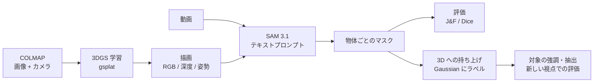

# SpatialSAM Studio

テキストで「何を切り出すか」を指定して、**動画**と **3D シーン（3D Gaussian Splatting）**をセグメンテーションする Streamlit アプリです。
オープンウェイトの [SAM 3.1](https://huggingface.co/facebook/sam3.1) と [gsplat](https://github.com/nerfstudio-project/gsplat) を使い、
推論・3DGS の学習・描画をすべて**ローカル GPU（8GB VRAM で動作確認）**で行います。外部の推論 API は使いません。



| フェーズ | できること | 主な結果（Mip-NeRF 360 bonsai / DAVIS 2017） |
|---|---|---|
| 1. 動画セグメンテーション | 動画 + テキスト → SAM 3.1 で物体ごとに追跡、正解マスクとの評価 | DAVIS の単一物体 6 本で J&F 0.95〜0.97、100 フレームで VRAM 約 4.7GB |
| 2. 3DGS の学習と描画 | COLMAP から 3DGS を学習し、任意のカメラ軌道で RGB・深度・姿勢付きの動画を作る | 7000 step で評価用視点の PSNR 30.7 / SSIM 0.943（9 分、VRAM 1.2GB） |
| 3. テキストによる 3D セグメンテーション | 描画動画への SAM の結果を、深度と姿勢で Gaussian に持ち上げる | 学習・持ち上げに使っていない視点で、実画像の SAM と IoU 0.908（bonsai）/ 0.927（table） |

デモ動画（bonsai の一連の流れ）は `scripts/record_demo.py` で録画できます（[デモ動画を録る](#デモ動画を録る)）。

---

## 目次

- [動作環境](#動作環境)
- [セットアップ](#セットアップ)
- [起動と画面の使い方](#起動と画面の使い方)
- [bonsai で一連の流れを試す](#bonsai-で一連の流れを試す)
- [コマンドラインのスクリプト](#コマンドラインのスクリプト)
- [MLflow で実験を一覧・比較する](#mlflow-で実験を一覧比較する)
- [設定](#設定)
- [出力の保存先](#出力の保存先)
- [構成](#構成)
- [開発](#開発)
- [ライセンスとデータの扱い](#ライセンスとデータの扱い)
- [関連ドキュメント](#関連ドキュメント)

---

## 動作環境

| 項目 | 確認した環境 / 必要条件 |
|---|---|
| OS | Linux（Ubuntu 系で確認） |
| GPU | NVIDIA RTX A1000 8GB（Ampere, sm_86）。8GB 以上の NVIDIA GPU を想定 |
| NVIDIA ドライバ | **CUDA 13.0 以上に対応**していること（PyTorch の cu130 ビルドを使うため） |
| CUDA ツールチェーン | **不要**（nvcc は pip 版を venv に入れて使う） |
| Python / パッケージ管理 | Python 3.12、[uv](https://docs.astral.sh/uv/)（0.7.9 で確認） |
| ディスク | venv 約 6GB、SAM 3.1 の重み約 3.5GB、gsplat のビルド結果約 0.8GB、DAVIS のアーカイブ 833MB、bonsai のデータ 1.4GB |

GPU が無い環境でも、セグメンタに `fake` を選べば UI とパイプラインの動きを確認できます（結果はダミー）。

---

## セットアップ

### 1. 依存関係のインストール

```bash
uv sync                  # 全依存（PyTorch 2.10 cu130、sam3、gsplat、開発用ツール）
uv sync --no-group gpu   # GPU 無しの環境（UI・評価・fake セグメンタだけ）
```

- PyTorch は `pyproject.toml` で cu130 のインデックスに固定しています。
- sam3 は公式リポジトリ（`facebookresearch/sam3`）のコミットを固定して git から入れます。

### 2. SAM 3.1 の重み

[`facebook/sam3.1`](https://huggingface.co/facebook/sam3.1) は承認制のリポジトリです。Hugging Face のページでアクセスを申請し、承認されてから取得します。

```bash
hf auth login
hf download facebook/sam3.1 --revision daa63191845a41281374e725f4c9e51c7a824460
```

- 使う重みは `configs/model.yaml` の `sam31.source.revision` で固定しています。HF のキャッシュから読むので、取得後は `HF_HUB_OFFLINE=1` でも動きます。
- fine-grained トークンを使う場合は、「public gated repos への読み取り」権限を付けてください。付けないと 403 になります。
- 別の場所に置いた重みを使うときは、`sam31.checkpoint_path` にパスを書きます。

### 3. gsplat の CUDA カーネル（初回だけ自動でビルド）

gsplat 1.5.3 には PyTorch 2.10 向けのビルド済みパッケージが無いので、初回の import 時に CUDA カーネルをビルドします（A1000 で約 2 分）。

- `spatialsam.spatial.cuda_env` が、venv に入れた pip 版 nvcc を自動で使います。
- ビルドするのはこの GPU のアーキテクチャ向けだけです。
- 結果は `~/.cache/spatialsam/torch_extensions` に保存し、2 回目からは数秒で読み込みます。

### 4. 正解マスク付きのサンプル動画（DAVIS 2017）

```bash
uv run python scripts/prepare_samples.py
```

DAVIS 2017（TrainVal 480p、833MB）をダウンロードして sha256 で検証し、7 本の動画と正解マスクを `samples/` に作ります。
シーケンスとプロンプト例は `configs/samples.yaml`、詳細は [samples/README.md](samples/README.md) にあります。

### 5. 3D シーンのデータ（Mip-NeRF 360）

フェーズ 2・3 には、COLMAP で姿勢推定済みの画像データを使います。例では [Mip-NeRF 360](https://jonbarron.info/mipnerf360/) の bonsai を使います。

```bash
# 公式の 360_v2.zip（約 12GB）から bonsai だけを取り出す例
curl -LO http://storage.googleapis.com/gresearch/refraw360/360_v2.zip
unzip 360_v2.zip 'bonsai/*' -d data/
# → data/bonsai/{images, images_2, images_4, images_8, sparse/0/{cameras,images,points3D}.bin}
```

- 8GB VRAM では、1/4 に縮小した画像（`images_4`）での学習を推奨します。
- データはリポジトリに含めません。利用条件は公式ページで確認してください。

---

## 起動と画面の使い方

```bash
uv run streamlit run app.py
```

左のサイドバーからページを選びます。トップページには、GPU の状態、使っているモデルとバージョン、出力先が表示されます。

### 1. Video Segmentation

**動画とテキストプロンプトから、SAM 3.1 で物体を切り出して追跡します。**

1. 動画をアップロードするか、サンプル動画または 3D 描画動画を選ぶ。サンプルを選ぶとプロンプト例が自動で入ります。
2. テキストプロンプトを入力する（例: `swan`、`bonsai`、`robot gripper`）。
3. サイドバーで推論の設定を調整する（フレームの間引き、最大フレーム数、入力の長辺）。
4. 「推論を実行」を押す。

結果として、元動画とマスク重畳動画の比較、フレームごとの元画像・重畳・マスク、物体ごとのスコアが表示されます。

- 同じ種類の物体が複数あれば、それぞれ別の物体 ID になります。
- 長い動画（既定では 200 フレームを超えるもの）は、重なり付きのチャンクに分けて推論し、物体 ID をつなぎます。
- GPU メモリが足りないときは、フレーム数を減らして自動で再実行します。

### 2. 3D Rendering

**「描画」タブ: 3D シーンをカメラ軌道に沿って描画し、動画にします。**

- **入力**: 3DGS の PLY、点群の PLY、COLMAP の sparse ディレクトリ（いずれか、または組み合わせ）。
- **軌道**:
  - オービット: 注視点の周りを一周する。COLMAP があれば、注視点・上方向・半径・仰角を撮影カメラから自動で推定します。
  - 撮影カメラの軌道: COLMAP の視点を順にたどる。学習時の評価用視点を除くこともできます。
- **出力**: RGB 動画・深度動画・可逆 PNG・深度データ・カメラ姿勢。
- 「この動画を Video Segmentation で使う」で、描画した動画を SAM の入力に渡せます。

**「3DGS 学習」タブ: COLMAP の画像とカメラから 3DGS を学習します。**

- gsplat の MCMC 戦略を使い、Gaussian 数に上限を付けて 8GB に収めます。
- 学習は**別プロセス**で動くので、ページを離れても止まりません。進捗は自動で更新されます。
- 画像は 8 枚に 1 枚を評価用に除き、学習に使っていない視点で PSNR / SSIM を出します。
- 終わったら「この 3DGS を描画タブの入力に設定」で、描画タブに渡せます。

### 3. 3D Segmentation

**3D 描画動画への SAM の結果を、描画時の深度とカメラ姿勢で Gaussian に持ち上げます。**

1. 入力が 3D 描画動画である SAM の実験を選ぶ。
2. 必要なら持ち上げの設定を変える（信頼度のしきい値、最少の可視視点数、深度の許容誤差）。
3. 「3D に持ち上げる」を押す。

- 各 Gaussian が、見えている視点でマスクの内側に写った割合（信頼度）でラベルが決まります。
- 視点を動かしながら「元のシーン / 対象を強調 / 対象だけ」を並べて見られます。対象の Gaussian は PLY でダウンロードできます。
- 「実画像 vs 3D 描画」の比較結果を選ぶと、学習にも持ち上げにも使っていない視点の実画像で評価します（再投影 IoU）。

### 4. Evaluation

| タブ | 内容 |
|---|---|
| GT マスクとの評価 | 正解マスク（PNG 連番の zip またはディレクトリ）と比べて、IoU（J）・輪郭 F・J&F・Dice をフレームごとに出す。サンプル動画なら正解は自動で選ばれる |
| 実画像 vs 3D 描画 | 評価用視点で、実画像・学習した 3DGS・点群の描画を、画質（PSNR / SSIM / LPIPS）と SAM 3.1 の結果で比べる。「比較を実行する」から別プロセスで実行でき、結果は視点ごとに並べて見られる |

ページの下には実験の一覧があり、CSV で出力できます。

> **GPU の排他**: 8GB に収めるため、3DGS の学習・比較・SAM の推論は同時に動かしません。どれかが動いている間は、ほかの実行ボタンが押せなくなります。

---

## bonsai で一連の流れを試す

Mip-NeRF 360 の bonsai を `data/bonsai` に置いた場合の手順です。すべて画面から操作できます。

1. **3DGS を学習する**（約 9 分）: 3D Rendering → 3DGS 学習。sparse ディレクトリに `data/bonsai/sparse/0` を入れて「学習を開始」。画像ディレクトリ（`images_4`）は自動で入ります。
2. **描画する**: 学習が終わったら「この 3DGS を描画タブの入力に設定」→ 描画タブで次のように設定して「描画」。
   - 軌道: 撮影カメラの軌道
   - 間引き: 3
   - 長辺: 780
   - 評価用視点を除く間隔: 8
3. **SAM で推論する**（約 1.5 分）: 「この動画を Video Segmentation で使う」→ プロンプト `bonsai` で推論。
4. **3D に持ち上げる**（約 30 秒）: 3D Segmentation で、いま作った実験を選んで「3D に持ち上げる」。盆栽の Gaussian（約 19 万個）が強調表示されます。
5. **実画像と比べる**（数分）: Evaluation → 実画像 vs 3D 描画 →「比較を実行する」。sparse ディレクトリとプロンプト `bonsai` を入れて開始します。
6. **3D の結果を評価する**: 3D Segmentation に戻り、比較結果を選んで「評価する」。評価用視点での再投影 IoU が出ます。

---

## コマンドラインのスクリプト

画面と同じ処理を CLI からも実行できます。結果は画面で作ったものと同じく `outputs/` に保存され、画面からも見られます。

| スクリプト | 内容 |
|---|---|
| `scripts/prepare_samples.py` | DAVIS 2017 から正解マスク付きサンプルを `samples/` に作る |
| `scripts/benchmark_samples.py` | サンプルを一括で推論・評価し、CSV にまとめる |
| `scripts/train_3dgs.py` | COLMAP から 3DGS を学習する（`--background` で別プロセス） |
| `scripts/compare_render_vs_real.py` | 評価用視点で、実画像と 3D 描画を画質と SAM の結果で比べる |
| `scripts/lift_masks.py` | SAM の 2D マスクを Gaussian に持ち上げる（`--compare` で評価も） |
| `scripts/record_demo.py` | bonsai の一連の流れをデモ動画に録る |

```bash
# DAVIS サンプルの一括評価（bf16 化の影響を見るときは --fp32-backbone）
HF_HUB_OFFLINE=1 uv run python scripts/benchmark_samples.py [--samples blackswan cows] [--max-frames 50]

# 3DGS の学習
uv run python scripts/train_3dgs.py --sparse data/bonsai/sparse/0 --images data/bonsai/images_4 \
    --steps 7000 --cap-max 1000000 [--background]

# 実画像 vs 3D 描画（3DGS と点群、プロンプト 2 つ）
uv run python scripts/compare_render_vs_real.py --sparse data/bonsai/sparse/0 --images data/bonsai/images_4 \
    --source 3dgs=outputs/training/<job_id>/point_cloud.ply --points --prompt bonsai --prompt table

# 2D マスクの持ち上げと評価
uv run python scripts/lift_masks.py --experiment <experiment_id> --compare <comparison_id> [--min-ratio 0.5]
```

### デモ動画を録る

学習済みの 3DGS と比較結果がある状態で実行します。

- スクリプトが Streamlit を起動し、システムの Google Chrome を Playwright で操作して、bonsai の一連の流れを録画します。
- 字幕とカーソルを表示し、GPU の待ち時間は 8 倍速にします。

```bash
uv run playwright install ffmpeg          # 初回だけ（Playwright の録画用 ffmpeg）
uv run python scripts/record_demo.py      # → outputs/demo/bonsai_demo.mp4（1440x900、約 2 分）
```

---

## MLflow で実験を一覧・比較する

結果は `outputs/` に保存したうえで、ローカルの [MLflow](https://mlflow.org/) トラッキングサーバー（Docker）にも記録します。
MLflow は一覧・比較のための追加の記録先で、正の保存先は `outputs/` のままです。

```bash
docker compose -f docker/mlflow/compose.yaml up -d    # 起動 → http://127.0.0.1:5000
docker compose -f docker/mlflow/compose.yaml down     # 停止（記録は Docker ボリューム spatialsam-mlflow に残る）
```

- サーバーは `127.0.0.1` だけで待ち受けます。データは外に出ません。
- MLflow 3.17.1 に固定しています（クライアントの `mlflow-skinny` と同じ版）。

| MLflow の experiment | 1 つの run の中身 |
|---|---|
| `spatialsam/segmentation` | SAM の実験。プロンプト・モデル・サンプリング、処理時間・VRAM・物体数、重畳動画と metadata。GT で評価すると、同じ run に `eval.J` / `eval.F` / `eval.J_and_F` / `eval.Dice` が加わる |
| `spatialsam/render` | 描画。シーン・軌道、フレーム数・時間・VRAM |
| `spatialsam/training` | 3DGS 学習。設定と、step ごとの学習曲線（`train.loss` / `train.psnr` / `train.num_gaussians`）、評価用視点の PSNR / SSIM |
| `spatialsam/comparison` | 実画像 vs 3D 描画。ソースごとの画質、プロンプト × ソースごとの検出率と IoU |
| `spatialsam/segmentation3d` | 3D セグメンテーション。ラベル数・信頼度・再投影 IoU |

- 宛先は `configs/model.yaml` の `tracking.mlflow_uri` で決まります（既定 `http://127.0.0.1:5000`、`null` で無効）。環境変数 `MLFLOW_TRACKING_URI` があれば、そちらを優先します。
- サーバーが起動していないときは警告を 1 回出し、記録だけを飛ばします。アプリや CLI はそのまま動きます。
- run はタグ `spatialsam.id`（`outputs/` の ID と同じ）で引き当てられます。
- 学習した PLY のような大きなファイルは送りません。

---

## 設定

`configs/model.yaml` で設定します。主な項目は次のとおりです。

| 項目 | 既定値 | 説明 |
|---|---|---|
| `default_segmenter` | `sam3.1` | 画面のセグメンタの初期値（`sam3.1` / `fake`） |
| `sam31.source.repo_id` / `revision` | `facebook/sam3.1` / `daa6319…` | 使う重み（revision で固定） |
| `sam31.checkpoint_path` | `null` | 別の場所の重みを使うときのパス |
| `sam31.score_threshold` | 0.5 | 出力する物体のスコアのしきい値 |
| `sam31.grounding_batch_size` | 1 | 画像エンコーダに一度に通すフレーム数。公式の既定値 16 は 8GB に収まらない |
| `sam31.bf16_backbone` | true | 画像・テキストエンコーダだけ bf16 にする（精度差は実質無く、VRAM は約 2.5GB 減る） |
| `sam31.offload_video_to_cpu` | true | デコードしたフレームを CPU メモリに置く |
| `chunking.chunk_size` / `overlap` / `match_iou` | 200 / 48 / 0.3 | 長い動画のチャンク分割。`chunking: null` で無効にする |
| `tracking.mlflow_uri` / `log_artifacts` | `http://127.0.0.1:5000` / true | MLflow への記録（`null` で無効）と、ファイルも送るか |
| `outputs_dir` | `outputs` | 出力先 |
| `max_upload_mib` | 500 | アップロードできる動画の上限 |

DAVIS サンプルの一覧とプロンプト例は `configs/samples.yaml` にあります。

---

## 出力の保存先

すべて `outputs/`（git の管理外）に保存します。

```text
outputs/
├── <experiment_id>/              SAM の実験: 入力動画、抽出フレーム、物体ごとのマスク（npz）、tracks.json、
│                                 重畳動画、metadata.json（モデルと revision、設定、性能、チャンク情報）、評価結果
├── renders/<render_id>/          描画: <render_id>.mp4、depth.mp4、rgb/*.png、depth/*.npz、poses.json、metadata.json
├── training/<job_id>/            3DGS 学習: request.json、status.json、train.log、point_cloud.ply、metrics.json
├── comparisons/<id>/             実画像 vs 3D 描画: 各ソースの画像と動画、quality.csv、masks.csv、summary.json
├── comparison_jobs/<job_id>/     比較ジョブの状態とログ
├── segmentation3d/<id>/          3D セグメンテーション: labels.npz、object.ply、summary.json（評価を含む）
├── benchmarks/                   サンプルの一括評価の CSV
└── demo/                         デモ動画
```

---

## 構成

```text
app.py                         トップページ（GPU の状態、モデル、出力先）
pages/
  1_video_segmentation.py      動画 + テキスト → SAM 3.1
  2_3d_rendering.py            3D シーンの描画、3DGS の学習
  3_3d_segmentation.py         2D マスクの 3D への持ち上げ、強調表示・抽出・評価
  4_evaluation.py              正解マスクとの評価、実画像 vs 3D 描画、実験一覧
configs/                       model.yaml（モデルと推論の設定）、samples.yaml（DAVIS サンプル）
src/spatialsam/
  models/                      セグメンタ（SAM 3.1 / fake）、チャンク分割、重みの解決、GPU 計測、モデルの保持
  video/                       動画の読み書き、マスクの重畳、深度の可視化、アップロードの検査
  evaluation/                  IoU / Dice / 輪郭 F / J&F、画質（PSNR / SSIM / LPIPS）、3D の評価
  experiments/                 実験・描画・比較・3D セグメンテーションの保存
  pipeline/                    推論・評価・描画・比較・持ち上げの一連の処理、比較ジョブ
  spatial/                     3DGS / 点群 / COLMAP の読み込み、gsplat の描画、カメラと軌道、持ち上げ
  training/                    gsplat による 3DGS の学習と学習ジョブ
  samples/                     DAVIS サンプルの作成
  ui/                          Streamlit の共通部品（学習・比較のパネルなど）
  jobs.py                      別プロセスジョブの共通の仕組みと GPU の排他
scripts/                       CLI（上の表を参照）
tests/                         pytest
docs/                          設計・理論・結果のドキュメント
```

主なデータの流れは次のとおりです。

1. `pipeline/segmentation.py` が、フレーム抽出 → `VideoSegmenter.segment` → 保存 → 重畳動画を行う。
2. `pipeline/rendering.py` が、カメラ軌道ごとに `GaussianRenderer.render` を呼んで保存し、MP4 にする。
3. `pipeline/lifting.py` が、SAM の実験から描画結果（姿勢と深度）とシーンをたどり、`mask_lifting.lift_masks` で持ち上げる。

---

## 開発

```bash
uv run pytest            # 単体テスト（GPU があれば gsplat を使うテストも動く）
```

- 方針（`CLAUDE.md`）: パッケージ管理は uv、テストは pytest、関数は小さく SOLID 原則に沿って書く。
- 進め方: 作業ごとにブランチを切り、PR を出す。問題点や未対応の作業は GitHub の issue で管理し、PR の `Closes #N` で閉じる。進捗は [docs/todo.md](docs/todo.md) にまとめる。
- 外部の推論 API やクラウド GPU は使わない（オープンウェイトのモデルをローカル GPU で動かす）。

---

## ライセンスとデータの扱い

- **SAM 3.1 の重み**: [SAM License](https://huggingface.co/facebook/sam3.1)。利用には Hugging Face での承認が必要です。
- **DAVIS 2017**: CC BY-NC 4.0（非商用）。動画も正解マスクもリポジトリには含めず、`prepare_samples.py` で手元に作ります。
- **Mip-NeRF 360**: リポジトリには含めません。利用条件は公式ページで確認してください。
- **主な依存**: gsplat（Apache-2.0）、LPIPS（BSD-2）、Playwright（Apache-2.0）。
- このリポジトリのコード自体のライセンスはまだ決めていません。

---

## 関連ドキュメント

| ドキュメント | 内容 |
|---|---|
| [docs/spatialsam_design.md](docs/spatialsam_design.md) | 設計書（目的、構成、フェーズ、使うモデル） |
| [docs/theory.md](docs/theory.md) | 理論背景・処理の流れ・数式の詳しい解説 |
| [docs/benchmark_sam31.md](docs/benchmark_sam31.md) | SAM 3.1 の実機での計測（DAVIS、bf16 化、チャンク分割、フレーム 0 の補完） |
| [docs/render_vs_real.md](docs/render_vs_real.md) | 実画像 vs 3D 描画の比較結果 |
| [docs/segmentation3d.md](docs/segmentation3d.md) | テキストによる 3D セグメンテーションの方法と結果 |
| [docs/todo.md](docs/todo.md) | 進捗のチェックリスト |
| [samples/README.md](samples/README.md) | DAVIS サンプルの作り方と内容 |
