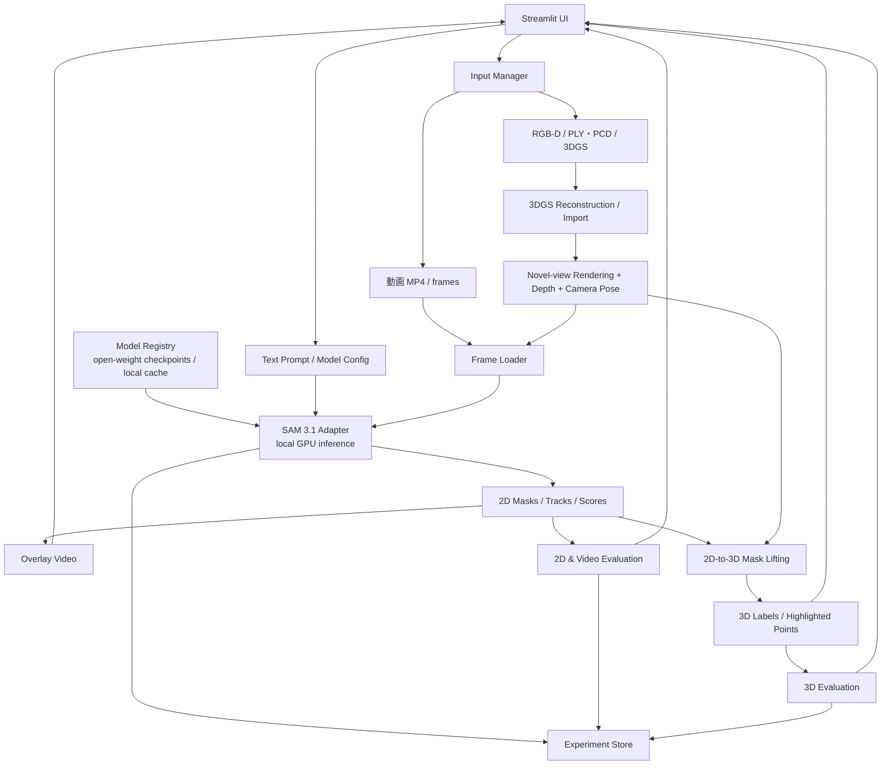

# SpatialSAM Studio — 設計方針

> **目的**：Streamlitを用いて、テキスト入力によるSAM 3.1の動画セグメンテーション、精度評価、点群・3D Gaussian Splatting（3DGS）との統合を段階的に実現する。
>
> **開発原則**：まず動画セグメンテーションを独立して完成させ、続いて3DGSレンダリングを接続し、最後に2Dマスクを3D空間へ統合する。
>
> **実行方針**：**オープンウェイトのモデルのみを使い、推論・3DGS学習・レンダリングをすべてローカルGPUで実行する**。外部推論APIには依存しない（データを外部送信しない）。

## 1. 背景と狙い

- **動画理解**：自然言語プロンプト（例：`chair`, `robot gripper`, `red cube`）で対象をセグメンテーションし、動画中の一貫した追跡結果を確認する。
- **3D可視化**：点群・RGB-D・複数視点画像から3Dシーンを用意し、3DGSで任意視点の画像・動画を生成する。
- **2D→3D統合**：セグメンテーション結果を深度、カメラパラメータ、可視性情報に基づいて3D空間へ対応付ける。
- **定量評価**：Ground Truth（正解データ）に対して2D・動画・3D・レンダリング品質・性能を個別評価する。
- **研究応用**：ロボットのグリッパ・対象物体・作業台の認識、遮蔽への頑健性、視点変化への一貫性を検証する。

## 2. スコープと前提

### 対象

- UIは **Streamlit**。動画アップロード、テキスト入力、結果重畳、メトリクス表示を提供する。
- モデルは **SAM 3.1（Meta, 2026-03-27公開、Object Multiplex）** の動画セグメンテーションを抽象化して接続する。**オープンウェイト [`facebook/sam3.1`](https://huggingface.co/facebook/sam3.1) をローカルにダウンロードし、公式リポジトリ [`facebookresearch/sam3`](https://github.com/facebookresearch/sam3) のコードでローカルGPU推論する**（詳細は§10.2）。
- チェックポイントはローカルキャッシュ（例：`~/.cache/huggingface` または `models/`）に固定バージョンで保存し、オフライン（`HF_HUB_OFFLINE=1`）でも起動できるようにする。
- 入力は段階的に、MP4 → RGB-D/点群/3DGSシーンへ拡張する。
- 再現可能性のため、モデル設定、プロンプト、データセット、カメラ姿勢、評価条件を保存する。

### 非対象（初期版）

- 大規模3DGSのフル学習をStreamlitのリクエスト内で直接実行すること。
- 2D IoUだけで3D精度を保証すること。
- 静的3DGSから、物体そのものが動く動画を自動生成すること。

### 技術上の注意

1. **点群を画像化することと3DGSを学習することは別**。高品質な3DGSでは通常、画像・カメラ姿勢・初期点群等を使ってGaussianを最適化する。
2. 静的3DGSからレンダリングする動画は原則として**仮想カメラの移動による動画**。動くロボット・物体を表現するには時系列の再構成または動的表現が必要。
3. **SAM出力は原則2Dマスク**。3D物体の領域取得には深度・外部/内部パラメータと複数視点の整合処理が必要。
4. **精度評価には正解マスク・正解ラベルが必要**。モデルの信頼度をそのまま精度と呼ばない。

## 3. システム構成



### コンポーネント責務

| コンポーネント | 主な責務 | 技術候補 |
|---|---|---|
| Streamlit UI | ファイル入力、プロンプト、動画・3D表示、比較と評価 | Streamlit、Plotly |
| Video Pipeline | フレーム抽出、FPS・解像度統一、動画書き出し | OpenCV、FFmpeg |
| SAM Adapter | ローカルGPU上のオープンウェイトモデルへの入力変換、推論実行、出力正規化 | PyTorch（CUDA）、公式リポジトリ／transformers |
| Point Cloud Pipeline | 点群読み込み、座標系・色情報・外れ値処理 | Open3D、NumPy |
| 3DGS Pipeline | 3DGSインポート・ローカルGPU学習・描画、カメラ軌道管理 | gsplat（CUDA） |
| Model Registry | チェックポイントの取得・バージョン固定・VRAM管理（ロード／解放） | huggingface_hub、PyTorch |
| Mask Lifting | 2Dマスクから3D点/Gaussianへのラベル対応 | NumPy、PyTorch |
| Evaluation | IoU、Dice、J&F、3D IoU等を計算 | TorchMetrics、独自実装 |
| Experiment Store | 入出力、設定、メトリクス、成果物の記録 | MLflow またはローカル保存 |

## 4. Streamlit画面設計

### タブ構成

**Tab 1 — Video Segmentation**

- MP4アップロード、サンプル動画選択
- テキストプロンプト入力・編集
- 推論設定（フレーム間引き、入力解像度、閾値等、モデルが対応する範囲）
- 元動画／マスク重畳動画／マスク単体の比較
- 対象ごとの追跡ID、フレーム別の結果表示

**Tab 2 — 3D Scene & Rendering**

- PLY/PCD、RGB-D、既存3DGSシーンの読み込み
- 3Dプレビュー、カメラ軌道の設定
- RGB・Depth・Camera Poseを含むレンダリング結果の出力
- 生成したMP4をTab 1へ渡す

**Tab 3 — 3D Segmentation**

- 動画から得た2Dマスクの3D対応付け
- 点群および可能ならGaussian単位の対象物体ハイライト
- 視点別の一貫性と3Dラベルの可視化

**Tab 4 — Evaluation & Experiments**

- 正解マスク／正解3Dラベルの取り込み
- 2D・動画・3D・レンダリング品質・性能のメトリクス表示
- 実画像と3DGSレンダリング画像の比較
- プロンプト別・シーン別の結果一覧、CSV/JSONエクスポート

### 最小操作フロー

1. 動画を選択する。
2. プロンプトを入力する（例：`robot gripper`）。
3. 推論を実行する。
4. 動画とマスクの重畳表示を確認する。
5. Ground Truthがある場合に精度を計算する。
6. 設定・評価値・出力動画を実験単位で保存する。

## 5. データフローと入出力

### 共通データモデル（案）

```text
Experiment
├── metadata.json              # experiment_id, model, timestamp, prompt, configs
├── input/
│   ├── video.mp4
│   └── scene/                  # point cloud / gaussian scene, optional
├── frames/                     # frame_000000.png ...
├── camera/
│   ├── intrinsics.json         # K
│   ├── poses.json              # T_world_from_camera
│   └── depth/                  # depth maps, optional
├── prediction/
│   ├── masks/                  # frame, object ID, masks
│   ├── tracks.json             # object ID / frame associations
│   └── overlay.mp4
├── ground_truth/
│   ├── masks/                  # optional
│   └── labels_3d.*            # optional
└── evaluation/
    ├── metrics.json
    └── per_frame.csv
```

**必須整合条件**：全データで座標系、カメラ姿勢の向き、depth単位、タイムスタンプ、フレーム対応を明記する。

## 6. 精度評価方針

| レベル | メトリクス | 必要な正解データ | 評価目的 |
|---|---|---|---|
| 2Dセグメンテーション | IoU、Dice、mIoU | フレームごとのGTマスク | ピクセル単位の領域一致 |
| 動画セグメンテーション | J&F、フレーム別IoU | 時系列GTマスク | 時間方向の輪郭と領域の一致 |
| 物体追跡 | IDF1、ID Switch | ID付き時系列GT | ID継続性（適切な追跡定義に限定） |
| 3D認識 | 3D IoU、Precision、Recall | 3D点／ボクセル／Gaussian等のGTラベル | 3D領域一致 |
| 3DGSレンダリング | PSNR、SSIM、LPIPS | 対応する実画像 | 新規視点描画品質 |
| システム性能 | Latency、FPS、Peak VRAM | GT不要 | 実運用性能 |

2D Intersection over Union:

$$
\mathrm{IoU} = \frac{|M_{\mathrm{pred}}\cap M_{\mathrm{GT}}|}{|M_{\mathrm{pred}}\cup M_{\mathrm{GT}}|}
$$

Dice:

$$
\mathrm{Dice} = \frac{2|M_{\mathrm{pred}}\cap M_{\mathrm{GT}}|}{|M_{\mathrm{pred}}| + |M_{\mathrm{GT}}|}
$$

- **J&F**：一般に領域一致のJaccard（J）と輪郭F-measure（F）の平均として算出する。ベンチマークの公式定義に合わせる。
- **mIoU**：クラス別／物体別／フレーム別の集約単位を固定する。
- **3D IoU**：点単位、ボクセル単位、Gaussian単位では意味が異なるので評価単位を明記する。
- **比較条件**：入力の実画像と3DGSレンダリング画像を別系列として評価し、再構成起因のエラーとモデル起因のエラーを分ける。
- **再現性**：モデルバージョン、プロンプト、フレームサンプリング、閾値、評価対象フレーム、GTバージョンを固定する。

## 7. 2Dマスクの3D対応付け

RGB画像上のピクセル `(u, v)` と深度 `z` が得られる場合、カメラ内部行列 `K` とカメラ→ワールド変換を用いて逆投影する。

$$
\mathbf{p}_{\mathrm{world}} = T_{\mathrm{world}\leftarrow\mathrm{cam}} \begin{bmatrix} z K^{-1}[u,v,1]^\top \\ 1 \end{bmatrix}
$$

**処理手順**：

1. 3DGSで同一視点のRGB、Depth、カメラ姿勢を描画・保持する。
2. SAMの2Dマスクで対象ピクセルを抽出する。
3. 深度を使って3D座標へ逆投影する。
4. 複数視点の結果を融合し、3D点群・ボクセル等にラベルを付ける。
5. Gaussian単位のラベルが必要なら、レンダリング時の可視性とalpha寄与度を考慮して集約する。
6. 3D GTがあれば3D IoU等で評価する。

**リスク**：遮蔽、深度推定誤差、反射面、浮遊Gaussian、重複領域、座標ずれ。マルチビュー一貫性チェックと信頼度の可視化が必要。

## 8. 開発ロードマップ

### Phase 1 — Video Segmentation & Evaluation Studio（MVP）

**機能**

- MP4アップロード・デコード
- テキスト入力による対象指定
- オープンウェイトのチェックポイント取得・ローカルキャッシュ（Model Registry）
- SAMアダプタ（ローカルGPU推論）からマスク・追跡結果を取得
- GPU状態（デバイス名・空きVRAM）の表示
- Overlay MP4生成
- 正解マスク入力、IoU・Dice・J&Fの評価
- レポート（JSON/CSV）と結果動画の保存

**完了条件**

- サンプル動画に対し入力→推論→可視化まで一連で動く
- `HF_HUB_OFFLINE=1`（ネットワーク無し）でも推論まで動作する
- 8GB VRAMでOOMせずに推論でき、Peak VRAMと処理時間を記録できる
- GT付きサンプルでメトリクスを再現可能に計算できる
- 推論設定（モデル名・チェックポイントのrevision含む）と出力を実験ごとに保存できる

### Phase 2 — Point Cloud / 3DGS Rendering

**機能**

- PLY/PCDおよび既存3DGSシーンのインポート
- 3Dプレビューとカメラ軌道設定
- RGB/Depth/Pose付きのフレーム生成、MP4化
- 同一対象について実画像とレンダリング画像でSAM性能を比較

**完了条件**

- 3Dシーンから動画とカメラメタデータを再現可能に出力できる
- 生成動画をPhase 1パイプラインに投入できる
- レンダリング画質とセグメンテーション精度の比較ができる

### Phase 3 — Text-to-3D Segmentation

**機能**

- 2D Mask Lifting（深度とカメラ姿勢）
- 複数視点での統合・整合性の確認
- 3D点群／Gaussianの対象ハイライト
- 3D GTがある場合の精度評価

**完了条件**

- テキストで指定した対象を3D可視化できる
- 再投影による2D↔3D整合性を確認できる
- 3D評価の定義と数値を記録できる

## 9. 推奨コード構成

```text
spatialsam-studio/
├── app.py
├── pages/
│   ├── 1_video_segmentation.py
│   ├── 2_3d_rendering.py
│   ├── 3_3d_segmentation.py
│   └── 4_evaluation.py
├── src/
│   ├── models/sam_adapter.py
│   ├── models/registry.py      # チェックポイント取得・VRAM管理
│   ├── video/io.py
│   ├── video/overlay.py
│   ├── spatial/pointcloud.py
│   ├── spatial/gs_renderer.py
│   ├── spatial/mask_lifting.py
│   ├── evaluation/segmentation.py
│   ├── evaluation/tracking.py
│   ├── evaluation/geometry.py
│   └── experiments/store.py
├── configs/
├── tests/
├── samples/
├── outputs/
├── pyproject.toml
└── README.md
```

設計ルール：UIと推論・評価ロジックを分離し、`sam_adapter.py`はモデル依存の呼び出しを隠蔽する。3DGS学習は必要に応じて独立ジョブに分ける。重い処理では非同期ジョブ化・キャッシュ・処理状況表示を採用する。

## 10. 開発環境と運用方針

### 10.1 ローカルGPU実行の前提

- **全処理をローカルGPU（想定：VRAM 8GB、CUDA）で完結**させる。外部API・リモート推論・クラウドGPUは使わない。
- 環境は `uv` で管理し、CUDA対応のPyTorchを `pyproject.toml` の index 指定で固定する。gsplatはCUDA拡張のため、PyTorch／CUDAバージョンとの整合を確認する。
- 起動時に `torch.cuda.is_available()`、GPU名、空きVRAMを確認し、UIに表示する。GPUが無い場合はエラーメッセージを出して推論系タブを無効化する。
- モデルの取得は初回のみ（`hf download` 等）。以後はオフラインで動作させる。

### 10.2 オープンウェイトモデル

| 用途 | モデル（候補） | 配布 | 備考 |
|---|---|---|---|
| テキスト指定の動画セグメンテーション（第一候補） | SAM 3.1 Object Multiplex（Meta） | HF: `facebook/sam3.1`（gated・手動承認） | `sam3.1_multiplex.pt`（約3.5GB）。transformers非対応のため公式repoの `build_sam3_multiplex_video_predictor()` で読み込む |
| テキスト指定の動画セグメンテーション（互換候補） | SAM 3（Meta） | HF: `facebook/sam3`（gated・手動承認） | `sam3.pt` に加え `model.safetensors` があり、transformers（`sam3_video`）でも使える |
| 代替（SAM 3が載らない場合） | Grounding DINO（tiny）+ SAM 2.1（tiny/small） | Hugging Face Hub / GitHub | テキスト→BBox検出→SAM 2の動画伝播で同等機能を構成 |
| 単眼深度（RGB-D無しの場合） | Depth Anything V2（Small） | Hugging Face Hub | Mask Lifting用の補助。スケール不定に注意 |
| 3DGS | gsplat | PyPI / GitHub（Apache-2.0） | 学習・ラスタライズともローカル |

`sam_adapter.py` は上記の差し替えを設定ファイル（`configs/model.yaml`）で切り替えられるインターフェースにする。

**SAM 3.1 の導入メモ**（2026-10-15 時点で確認）

- **ライセンス**：SAM License（HFでは `license: other`）。HFのモデルページでアクセス申請し、承認後に `hf auth login` で認証してダウンロードする。
- **取得**：`hf download facebook/sam3.1 --revision daa63191845a41281374e725f4c9e51c7a824460`（commit SHAで固定）。
- **コード**：`facebookresearch/sam3` の最新版が必要（SAM 3.1 は旧バージョンのコードでは読み込めない）。公式の要件は Python 3.12以上、PyTorch 2.10 + CUDA 12.8。uvではgit依存として追加する。本リポジトリでは gsplat の JIT ビルドに pip 版 nvcc（CUDA 13 系のみ nvcc 本体を含む）を使うため、PyTorch 2.10 の cu130 ビルドを使う（SAM 3.1 の結果は cu128 と同一）。
- **API**：`from sam3.model_builder import build_sam3_multiplex_video_predictor` → `handle_request(type="start_session", resource_path=...)` → `handle_request(type="add_prompt", text=...)`。入力はMP4またはJPEGフレームのフォルダ。
- **8GB VRAM**：公式の速度評価はH100前提。チェックポイントはfp32で約3.5GB（パラメータ数は約8.7億と推定）なので、bf16にすれば重み自体は約1.8GBに収まる見込み。動画メモリと物体数に応じてVRAM使用量が増えるため、実測で確認する。

### 10.3 8GB VRAMでの運用ルール

- **モデルは同時に1つだけGPUに載せる**。タブ切替・処理切替時に `del model; torch.cuda.empty_cache()` で解放する（Model Registryが管理）。
- **SAM推論**：`bfloat16`/`float16` autocast、`torch.inference_mode()`、入力解像度の縮小、フレーム間引き、長尺動画はチャンク分割して処理する。動画メモリ（過去フレームの特徴）はCPUオフロードを有効にする。
- **3DGS学習（gsplat）**：画像を1/2〜1/4にダウンサンプル、`packed=True`、`sparse_grad`、MCMC戦略の `cap_max` でGaussian数に上限を設ける。学習はStreamlitプロセスとは別プロセス（ジョブ）で実行し、進捗をファイル経由でUIへ通知する。
- **SAM推論と3DGS学習を同時に実行しない**（ジョブキューで直列化）。
- OOM発生時は解像度・フレーム数・Gaussian上限を下げて自動リトライし、その設定を実験メタデータに記録する。

### 10.4 その他

- ファイルアップロード時はサイズ・形式を検査し、一時ファイルを適切に分離・削除する。
- データはローカルから外部に送信しないため、人物や機密情報を含む動画も扱える。ただし保存期間と出力物の管理は実験ストアで明示する。
- 推論速度・Peak VRAM（`torch.cuda.max_memory_allocated()`）を入力解像度、フレーム数、フレーム間引き設定ごとに測定・記録する。

## 11. 初期の研究・検証テーマ

1. **視点頑健性**：異なるカメラ軌道で同一物体のマスクはどの程度変化するか。
2. **実画像 vs 3DGS画像**：レンダリング画像の劣化が2D IoUに与える影響は何か。
3. **遮蔽耐性**：グリッパ・物体・作業台の部分遮蔽でIDや領域がどの程度保持されるか。
4. **3D一貫性**：複数視点で得た2Dマスクを統合したとき同一3D領域に収束するか。
5. **ロボット応用**：SO-101の作業空間で、対象物体とグリッパをテキスト指示で取り出せるか。

## 12. 推奨する着手順

1. `facebook/sam3.1` のアクセスを申請・取得し、**ローカル8GB GPUで推論できるか（Peak VRAM・速度）を検証**してアダプタ仕様を確定する。載らない場合は `facebook/sam3` → Grounding DINO + SAM 2.1 の順に切り替える。
2. Phase 1の最小ユースケース（MP4 + text prompt + overlay + IoU）を作る。
3. GT付き少量サンプルでメトリクス実装をテストする。
4. 既存3DGSシーンからの動画レンダリングを接続する。
5. 最後に2D→3Dラベル融合を実装する。

---

**最終到達点**：オープンウェイトのモデルとローカルGPUだけで、動画内の対象を自然言語で指定し、その認識結果を3D空間へ戻して可視化・定量評価できる実験プラットフォーム。
