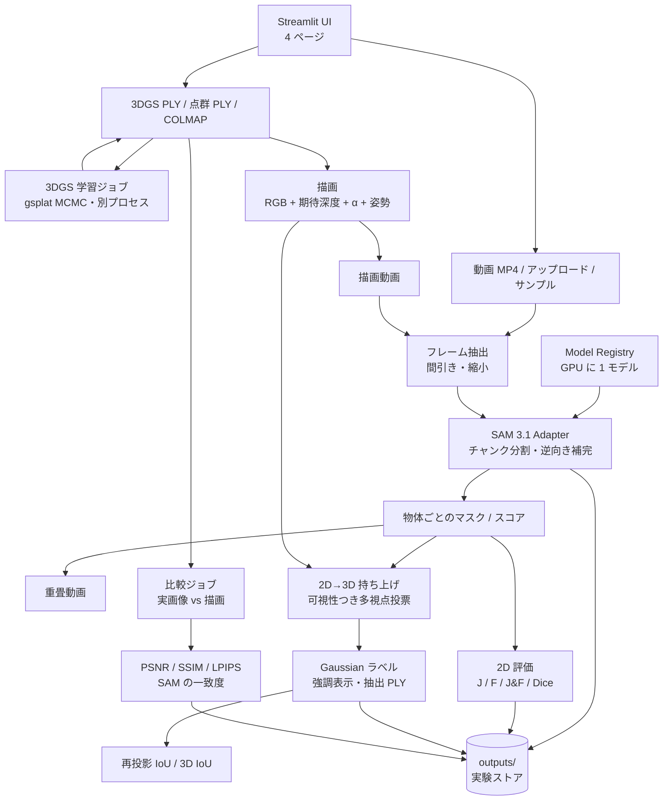

# SpatialSAM Studio — 設計書

> **目的**：Streamlit を用いて、テキスト入力による SAM 3.1 の動画セグメンテーション、精度評価、点群・3D Gaussian Splatting（3DGS）との統合を段階的に実現する。
>
> **開発原則**：まず動画セグメンテーションを独立して完成させ、続いて 3DGS レンダリングを接続し、最後に 2D マスクを 3D 空間へ統合する。
>
> **実行方針**：**オープンウェイトのモデルのみを使い、推論・3DGS 学習・レンダリングをすべてローカル GPU で実行する**。外部推論 API には依存しない（データを外部送信しない）。

**実装状況（2026-10-16）**：Phase 1〜3 を実装済み。
- 動作確認した環境: RTX A1000 8GB、PyTorch 2.10 cu130、SAM 3.1、gsplat 1.5.3。
- 理論と数式は [theory.md](theory.md)、実測は [benchmark_sam31.md](benchmark_sam31.md) / [render_vs_real.md](render_vs_real.md) / [segmentation3d.md](segmentation3d.md)、使い方は [README](../README.md) を参照。
- 当初の設計から変えた点は [§13](#13-当初設計からの変更点) にまとめた。

## 1. 背景と狙い

- **動画理解**：自然言語プロンプト（例：`chair`, `robot gripper`, `red cube`）で対象をセグメンテーションし、動画中の一貫した追跡結果を確認する。
- **3D 可視化**：点群・複数視点画像（COLMAP）から 3D シーンを用意し、3DGS で任意視点の画像・動画を生成する。
- **2D→3D 統合**：セグメンテーション結果を深度、カメラパラメータ、可視性情報に基づいて 3D 空間（Gaussian）へ対応付ける。
- **定量評価**：Ground Truth（正解データ）に対して、2D・動画・3D・レンダリング品質・性能を個別に評価する。
- **研究応用**：ロボットのグリッパ・対象物体・作業台の認識、遮蔽への頑健性、視点変化への一貫性を検証する。

## 2. スコープと前提

### 対象

- **UI**: Streamlit のマルチページアプリ（4 ページ）。
- **モデル**: **SAM 3.1（Meta、Object Multiplex）**。オープンウェイト [`facebook/sam3.1`](https://huggingface.co/facebook/sam3.1) をローカルにダウンロードし、公式リポジトリ [`facebookresearch/sam3`](https://github.com/facebookresearch/sam3) のコードでローカル GPU 推論する（§10.2）。
- **チェックポイント**: HF のキャッシュに revision（commit SHA）を固定して保存し、オフライン（`HF_HUB_OFFLINE=1`）でも起動できる。
- **入力**: MP4 動画、3DGS の PLY、点群の PLY、COLMAP の sparse モデル（cameras / images / points3D.bin）と画像。
- **再現性**: モデルと revision、プロンプト、サンプリング設定、カメラ軌道と姿勢、評価条件を、実験ごとに JSON で保存する。

### 非対象

- Streamlit のリクエスト内で 3DGS を学習すること。学習は別プロセスのジョブで行う（§10.3）。
- 2D IoU だけで 3D 精度を保証すること。3D の評価は再投影 IoU と 3D IoU で別に行う（§6）。
- 静的 3DGS から、物体そのものが動く動画を生成すること。
- RGB-D 入力、PCD 形式、単眼深度推定。いずれも未実装で、深度は 3DGS の描画から得る。

### 技術上の注意

1. **点群を画像化することと 3DGS を学習することは別**。
   - 実装では、点群をそのまま Gaussian にして描画することもできる（`spatial/pointcloud.py`）。
   - ただし画質は低く（bonsai で PSNR 10.5）、SAM はほとんど検出できない。学習した 3DGS は PSNR 30.7 だった。
2. 静的 3DGS からの動画は**仮想カメラの移動による動画**（オービット、または撮影カメラの軌道）。
3. **SAM の出力は 2D マスク**。3D の領域を得るには、深度・内部/外部パラメータ・複数視点の整合処理が要る（§7）。
4. **精度評価には正解が必要**。モデルの信頼度をそのまま精度と呼ばない。
   - 3D 描画の評価では正解マスクが無い。そのため「実画像での SAM の結果」を基準にした一致度として扱い、正解とは区別する。

## 3. システム構成



### コンポーネント責務

| コンポーネント | 主な責務 | 実装（`src/spatialsam/`） | 主な技術 |
|---|---|---|---|
| Streamlit UI | 入力、プロンプト、結果表示、比較・評価、ジョブの起動と進捗 | `pages/`、`ui/` | Streamlit |
| Video Pipeline | フレーム抽出（間引き・最大フレーム数・縮小）、H.264 での書き出し、重畳 | `video/` | OpenCV、imageio-ffmpeg |
| SAM Adapter | セッション管理、テキストプロンプト、前向きの伝播と逆向きの補完、出力の正規化 | `models/sam31_segmenter.py`、`models/sam3_compat.py` | PyTorch、sam3 |
| チャンク分割 | 長い動画を重なり付きで分割し、IoU とハンガリアン法で物体 ID をつなぐ | `models/chunking.py` | NumPy、SciPy |
| Model Registry | 重みの解決（revision 固定）、GPU に 1 モデルだけ保持、解放 | `models/checkpoint.py`、`models/registry.py`、`models/factory.py` | huggingface_hub |
| Point Cloud / Scene | 3DGS PLY・点群 PLY・COLMAP の読み込み、点群 → 等方 Gaussian | `spatial/gaussians.py`、`spatial/pointcloud.py`、`spatial/colmap.py`、`spatial/scene_source.py` | plyfile、SciPy |
| 3DGS Pipeline | 描画（RGB / 期待深度 / α / 特徴量）、カメラと軌道、学習 | `spatial/renderer.py`、`spatial/camera.py`、`spatial/trajectory.py`、`training/` | gsplat（JIT ビルド） |
| Mask Lifting | 逆投影、Gaussian 中心の投影と可視判定、多視点投票、強調・抽出 | `spatial/mask_lifting.py`、`spatial/scene_highlight.py`、`pipeline/lifting.py` | NumPy |
| Evaluation | IoU / Dice / 輪郭 F / J&F、PSNR / SSIM / LPIPS、再投影 IoU / 3D IoU | `evaluation/` | NumPy、PyTorch、lpips |
| Jobs | 別プロセスのジョブ（学習・比較）、状態ファイル、GPU 排他 | `jobs.py`、`training/jobs.py`、`pipeline/comparison_job.py` | subprocess |
| Experiment Store | 入出力、設定、メトリクス、成果物の保存 | `experiments/` | ローカルの JSON / CSV / NPZ |

## 4. Streamlit 画面設計

| ページ | 主な機能 |
|---|---|
| **1. Video Segmentation**（`pages/1_video_segmentation.py`） | 動画のアップロード、サンプル動画や 3D 描画動画の選択、テキストプロンプト（サンプルは例を自動入力）、推論設定（間引き、最大フレーム数、長辺）、元動画と重畳動画の比較、フレームごとの元画像・重畳・マスク、物体ごとのスコア、チャンク分割や OOM 縮小の表示 |
| **2. 3D Scene & Rendering**（`pages/2_3d_rendering.py`） | 【描画タブ】PLY / COLMAP の読み込み、オービット（撮影カメラから注視点・上方向・半径・仰角を推定）か撮影カメラの軌道（評価用視点の除外も可）、RGB / 深度動画の表示、Video Segmentation への受け渡し<br/>【3DGS 学習タブ】学習ジョブの起動、進捗の自動更新、結果を描画タブへ |
| **3. 3D Segmentation**（`pages/3_3d_segmentation.py`） | 3D 描画動画への SAM の実験を選んで持ち上げ（しきい値を調整できる）、信頼度の分布、元のシーン / 対象を強調 / 対象だけの並列表示、`object.ply` のダウンロード、評価用視点での再投影 IoU |
| **4. Evaluation & Experiments**（`pages/4_evaluation.py`） | 【GT マスクとの評価】J / F / J&F / Dice とフレームごとの推移（サンプル動画は GT を自動選択）<br/>【実画像 vs 3D 描画】比較ジョブの実行、画質と SAM の一致度、視点ごとの並列表示<br/>実験一覧と CSV / JSON の出力 |

トップページ（`app.py`）には、GPU の状態、モデルと revision、既定のセグメンタ、GPU 上のモデル、出力先を表示する。

### 最小操作フロー（動画）

1. 動画を選ぶ（サンプル動画ならプロンプト例が入る）。
2. プロンプトを入力して推論する。
3. 重畳動画とフレームごとのマスクを確認する。
4. Evaluation で GT と比べる（サンプル動画は GT を自動で選ぶ）。
5. 設定・評価値・出力動画は、実験ごとに `outputs/` に自動で保存される。

### 3D の操作フロー（bonsai）

学習（3DGS 学習タブ）→ 撮影カメラの軌道で描画 → Video Segmentation で「bonsai」→ 3D Segmentation で持ち上げ → Evaluation で実画像との比較 → 3D Segmentation で評価。
`scripts/record_demo.py` がこの流れを自動で操作し、デモ動画に録る。

## 5. データフローと入出力

すべて `outputs/` 以下に、種類ごとに保存する（`experiments/` のストア）。
描画・SAM・持ち上げは ID で互いを参照するので、どの描画結果からどの SAM 実験を作り、どう持ち上げたかを後からたどれる。

```text
outputs/
├── <experiment_id>/              # SAM の実験
│   ├── metadata.json             # プロンプト、モデル（segmenter, repo_id, revision）、入力、サンプリング（要求値と実際の値）、
│   │                             # OOM で縮小した記録、frame_indices（元動画のフレーム番号）、object_ids、性能、チャンク分割の情報
│   ├── input/<動画>               # 入力のコピー
│   ├── frames/00000.jpg ...      # SAM に渡したフレーム（間引き・縮小後）
│   ├── prediction/masks/*.npz    # フレームごと・物体 ID ごとのマスクとスコア
│   ├── prediction/tracks.json    # 物体 ID ごとの出現フレーム
│   ├── prediction/overlay.mp4
│   └── evaluation/metrics.json, per_frame.csv
├── renders/<render_id>/          # 3D 描画
│   ├── <render_id>.mp4, depth.mp4
│   ├── rgb/00000.png             # 可逆の RGB
│   ├── depth/00000.npz           # 期待深度（カメラ z）と α（float16）
│   ├── poses.json                # フレームごとの K、world_to_cam、解像度、元画像名
│   └── metadata.json             # シーンの入力（PLY / COLMAP）、軌道、性能
├── training/<job_id>/            # 3DGS 学習: request.json、status.json、train.log、point_cloud.ply、metrics.json
├── comparisons/<id>/             # 実画像 vs 描画: frames/<source>/、videos/、quality.csv、masks.csv、summary.json
├── comparison_jobs/<job_id>/     # 比較ジョブの状態とログ
├── segmentation3d/<id>/          # 持ち上げ: labels.npz（可視視点数・信頼度・ラベル）、object.ply、summary.json（評価を含む）
├── benchmarks/                   # DAVIS サンプルの一括評価
└── demo/                         # デモ動画
```

**整合の約束**（[theory.md §2](theory.md)）:
- カメラは OpenCV 規約（x 右・y 下・z 前方）で、`world_to_cam` を保存する。
- 深度はカメラ z 方向の期待深度で、単位はシーン（COLMAP）の単位。
- 画素中心は +0.5。
- フレームの対応は `frame_indices`（実験）と、描画のフレーム番号 = 描画動画のフレーム番号で取る。
- 縮小したときは K を縦横別々に縮め、動画のために縦横を偶数にそろえる。

## 6. 精度評価方針

| レベル | メトリクス | 基準 | 実装 |
|---|---|---|---|
| 2D / 動画セグメンテーション | IoU（J）、Dice、輪郭 F、J&F（フレームごと + 平均） | フレームごとの GT マスク（DAVIS） | `evaluation/segmentation.py`、`pipeline/evaluation.py` |
| 物体追跡 | IDF1、ID Switch | ID 付き時系列 GT | **未実装**（チャンク境界での ID の引き継ぎは記録する） |
| 3D セグメンテーション | 再投影 IoU、3D IoU | 評価用視点の実画像での SAM の結果 / 3D の正解ラベル | `evaluation/geometry.py`、`pipeline/lifting.py` |
| 3DGS 描画 | PSNR、SSIM、LPIPS（AlexNet） | 学習に使っていない視点の実画像 | `evaluation/image_quality.py`、`training/` |
| 実画像 vs 描画での SAM | 検出率、実画像のマスクとの IoU | 実画像での SAM の結果 | `pipeline/comparison.py` |
| システム性能 | 処理時間、Peak VRAM | GT 不要 | `models/gpu.py`（`torch.cuda.max_memory_allocated`） |

2D Intersection over Union と Dice:

$$
\mathrm{IoU} = \frac{|M_{\mathrm{pred}}\cap M_{\mathrm{GT}}|}{|M_{\mathrm{pred}}\cup M_{\mathrm{GT}}|}, \qquad
\mathrm{Dice} = \frac{2|M_{\mathrm{pred}}\cap M_{\mathrm{GT}}|}{|M_{\mathrm{pred}}| + |M_{\mathrm{GT}}|}
$$

### 実装で決めた評価の定義

- **2D の集約単位**: 全物体のマスクの和集合と、GT の前景（物体 ID > 0）を比べる。物体ごとの対応付けはしない。
  - そのため、GT の対象と同じ種類の物体が別に映る動画は、サンプルから外した（camel だけは比較用に残した）。
- **輪郭 F**: 許容距離 ⌈0.008 × 画像の対角長⌉ 画素での F 値（854×480 なら 8px）。
  - 輪郭の取り方は DAVIS の公式実装と同じではない（[theory.md §4](theory.md)）。
- **3D の評価単位**: Gaussian 単位。
  - **再投影 IoU**: 3D のラベルを gsplat で α 合成して評価用視点に描き（遮蔽を含む）、同じ視点の実画像での SAM の結果と比べる。
  - **3D IoU**: Gaussian 単位のラベル同士の IoU（正解ラベルがあればそれと比べる）。
  - 基準側（実画像の SAM）が見落とした視点は `reference_empty_views` として別に数える。
- **比較条件**: 実画像と描画画像を、同じ視点・同じ順序の動画にして同じプロンプトで推論し、別系列として扱う。再構成に起因する誤差とモデルに起因する誤差を分けるため。
- **再現性**: モデルの revision、プロンプト、フレームサンプリング（要求値と実際の値）、閾値、評価対象フレーム、評価用視点の規則（8 枚に 1 枚）を保存する。

## 7. 2D マスクの 3D への対応付け

RGB 画像上の画素 `(u, v)` と深度 `z` が得られる場合、カメラの内部行列 `K` とカメラ→ワールドの変換で逆投影する（`mask_lifting.backproject`）。

$$
\mathbf{p}_{\mathrm{world}} = T_{\mathrm{world}\leftarrow\mathrm{cam}} \begin{bmatrix} z K^{-1}[u+0.5,\ v+0.5,\ 1]^\top \\ 1 \end{bmatrix}
$$

Gaussian 単位のラベルは、点を融合するのではなく、**Gaussian の中心を各視点に投影して投票する**（`mask_lifting.lift_masks`）。

1. 3DGS を撮影カメラの軌道で描き、RGB・期待深度・α・姿勢を保存する。3D 評価を公平にするため、学習時の評価用視点は除く。
2. 描画動画に SAM 3.1 をかける。フレームの対応は `frame_indices` で取り、カメラと深度は SAM が推論した解像度に合わせる。
3. 各 Gaussian の中心 $\boldsymbol{\mu}_i$ を各視点に投影する。描画の α ≥ 0.5 で、かつ中心の深さが描画深度の 1.05 倍以内なら「見えている」とする（遮蔽された視点は数えない）。
4. 物体 ID ごとに、見えた視点のうちマスクの内側に写った割合（信頼度）を求める。信頼度 ≥ 0.5 かつ見えた視点が 2 以上なら、その物体のラベルを付ける。
5. 対象以外を暗くした描画や、対象だけを抜き出した PLY で可視化する。
6. 評価用視点への再投影 IoU と、3D IoU で評価する（§6）。

**リスクと対応**:
- **遮蔽**: 描画深度による可視判定で、遮蔽された視点を数えない。
- **浮遊 Gaussian・描画深度の誤差**: 許容誤差と α のしきい値で抑える。
- **座標のずれ**: OpenCV 規約に統一し、COLMAP の視点で描くと実画像と一致することを確認した。
- **限界**: 中心だけで判定するので、大きな Gaussian の扱いは粗い。

## 8. 開発ロードマップと実装状況

### Phase 1 — Video Segmentation & Evaluation Studio ✅

| 機能 | 状況 |
|---|---|
| MP4 アップロード・デコード、テキスト指定 | ✅ |
| オープンウェイトの重みの取得・revision 固定・ローカルキャッシュ | ✅ `models/checkpoint.py` |
| SAM アダプタ（ローカル GPU）、GPU 状態の表示、重畳動画 | ✅ |
| GT 入力、IoU / Dice / J&F、JSON / CSV の保存 | ✅ |
| GT 付きサンプル動画（DAVIS 2017 の 7 本） | ✅ `scripts/prepare_samples.py` |
| 長い動画のチャンク分割と ID の引き継ぎ（#9）、最初の検出より前の逆向き補完（#30） | ✅ |

**完了条件の確認**:
- サンプル動画で、入力 → 推論 → 可視化 → 評価が通る。
- `HF_HUB_OFFLINE=1` で推論できる。
- 8GB で OOM せずに推論でき、Peak VRAM と処理時間を記録する。
- DAVIS で J&F 0.95〜0.97 を再現できる。
- 実験ごとに revision と設定を保存する。

### Phase 2 — Point Cloud / 3DGS Rendering ✅

| 機能 | 状況 |
|---|---|
| 3DGS PLY・点群 PLY・COLMAP のインポート | ✅（PCD・RGB-D は未対応） |
| カメラ軌道（オービット・撮影カメラ）、RGB / 深度 / 姿勢付きフレーム、MP4 化 | ✅ |
| 生成動画を Phase 1 に投入 | ✅（Video Segmentation へ受け渡す） |
| 3DGS の学習（gsplat、MCMC、別プロセス） | ✅（設計では「必要に応じて」としていたが実装した） |
| 実画像と描画画像での画質・SAM の比較 | ✅ UI からも実行できる |
| 3D プレビュー（インタラクティブなビューア） | ❌ 未実装（描画した画像と動画で確認する） |

**完了条件の確認**:
- 3D シーンから動画と姿勢・深度を再現可能に出力できる。
- 生成動画を Phase 1 に投入できる。
- bonsai で画質（PSNR 30.7）と SAM の一致度（IoU 0.92〜0.98）を比べられた。

### Phase 3 — Text-to-3D Segmentation ✅

| 機能 | 状況 |
|---|---|
| 2D Mask Lifting（深度と姿勢、可視性つき多視点投票） | ✅ |
| 複数視点での統合・整合性（信頼度の分布、評価用視点への再投影） | ✅ |
| Gaussian の対象の強調表示・抽出 | ✅ |
| 3D の評価（再投影 IoU、3D IoU） | ✅（3D の正解ラベルを持つデータでの評価は未実施） |

**完了条件の確認**:
- テキストで指定した対象を 3D で可視化できる（bonsai は 19 万 Gaussian）。
- 再投影で 2D↔3D の整合を確認できる（評価用視点で IoU 0.908 / table は 0.927）。
- 3D 評価の定義と数値を記録する。

## 9. コード構成

```text
gaussian-sam-studio/
├── app.py                         # トップページ
├── pages/1_video_segmentation.py, 2_3d_rendering.py, 3_3d_segmentation.py, 4_evaluation.py
├── configs/model.yaml, samples.yaml
├── src/spatialsam/
│   ├── config.py                  # configs/model.yaml の読み込み
│   ├── jobs.py                    # 別プロセスジョブの共通部分と GPU 排他
│   ├── models/                    # types, segmenter（Protocol）, sam31_segmenter, sam3_compat, chunking,
│   │                              # checkpoint, registry, factory, fake_segmenter, gpu
│   ├── video/                     # io, overlay, depth, upload
│   ├── spatial/                   # gaussians, pointcloud, colmap, camera, trajectory, scene_source,
│   │                              # renderer, cuda_env, mask_lifting, scene_highlight
│   ├── training/                  # dataset, losses, trainer, jobs, run_job
│   ├── evaluation/                # segmentation, ground_truth, image_quality, geometry
│   ├── pipeline/                  # segmentation, retry, evaluation, rendering, comparison, comparison_job, lifting
│   ├── experiments/               # store, serialization, renders, comparisons, segmentation3d, benchmark
│   ├── samples/davis.py
│   └── ui/                        # state, training_panel, comparison_panel
├── scripts/                       # prepare_samples, benchmark_samples, train_3dgs, compare_render_vs_real,
│                                  # lift_masks, record_demo
├── tests/                         # pytest（GPU があれば gsplat を使うテストも動く）
├── docs/
├── samples/                       # DAVIS から生成（git の管理外）
├── outputs/                       # 実行結果（git の管理外）
└── pyproject.toml / uv.lock
```

**設計ルール**:
- UI（`pages/`、`ui/`）と、推論・評価のロジック（`src/spatialsam/`）を分ける。
- モデルは `VideoSegmenter`（Protocol）の背後に隠す。SAM 3.1 と fake に加え、チャンク分割も同じインターフェースのラッパーで実装した。
- 重い処理（3DGS 学習、比較）は別プロセスのジョブにし、状態はファイルで UI に伝える。
- 関数は小さく保つ（SOLID）。テストは pytest で書く。

## 10. 開発環境と運用方針

### 10.1 ローカル GPU での実行

- **全処理をローカル GPU（VRAM 8GB、CUDA）で完結させる**。外部 API、リモート推論、クラウド GPU は使わない。
- **環境**: `uv` で管理し、PyTorch 2.10 の **cu130 ビルド**を `pyproject.toml` のインデックス指定で固定する。NVIDIA ドライバは CUDA 13.0 以上に対応している必要がある。
- **gsplat**: 1.5.3 には PyTorch 2.10 向けのビルド済みパッケージが無いので、初回の import 時に CUDA カーネルを JIT ビルドする（約 2 分）。
  - `spatial/cuda_env.py` が、venv に入れた pip 版 nvcc（`nvidia-cuda-nvcc` 13.0、依存の nvvm / crt も 13.0 に固定）を `CUDA_HOME` にする。
  - ビルド対象はこの GPU のアーキテクチャだけにし、ビルド結果は `~/.cache/spatialsam/torch_extensions` に分けて置く。
  - **システムに CUDA ツールチェーンは要らない**。
- **起動時の表示**: GPU 名と空き VRAM。GPU が無い場合は警告を出し、`fake` セグメンタだけを使える。
- **モデルの取得**: 初回だけ（`hf download`）。以後はオフラインで動く。

### 10.2 オープンウェイトモデル

| 用途 | 採用したもの | 配布 | 備考 |
|---|---|---|---|
| テキスト指定の動画セグメンテーション | **SAM 3.1 Object Multiplex**（Meta） | HF: `facebook/sam3.1`（承認制） | `sam3.1_multiplex.pt`（約 3.5GB）。公式 repo の `build_sam3_multiplex_video_predictor()` で読み込む |
| 3DGS の学習・描画 | **gsplat 1.5.3** | PyPI（Apache-2.0） | MCMC 戦略、`packed=True` |
| 画質の評価 | **LPIPS**（AlexNet） | PyPI `lpips`（BSD-2） | AlexNet の重みは torchvision から初回だけ取得 |

**不要と判断した代替候補**:
- SAM 3（`facebook/sam3`）と、Grounding DINO + SAM 2.1 は、SAM 3.1 が 8GB に収まったので実装していない。
- 単眼深度（Depth Anything V2）は、深度を 3DGS の描画から得るので使っていない。

**SAM 3.1 の導入メモ**
- **ライセンス**: SAM License。HF でアクセスを申請し、承認後に `hf auth login`。fine-grained トークンには「public gated repos への読み取り」権限が要る。
- **取得**: `hf download facebook/sam3.1 --revision daa63191845a41281374e725f4c9e51c7a824460`（commit SHA で固定）。sam3 本体も git のコミット `7f473cf…` で固定する。
- **上流の不具合と依存の回避**:
  - `init_state()` の引数の不一致（上流 #544）は `models/sam3_compat.py` で回避している。
  - 宣言されていない依存（psutil、hydra-core、scipy、scikit-image、`setuptools<81`）は追加した。
  - `pyarrow<26` は numpy<2 と両立させるために固定している。
- **API**:
  1. `handle_request(start_session)`
  2. `handle_request(add_prompt, text)`（フレーム 0）
  3. `handle_stream_request(propagate_in_video, propagation_direction="forward")`
  4. 必要なら最初の検出フレームから `"backward"`
  5. `close_session`
- **8GB VRAM での実測**: 公式の既定（画像エンコーダのバッチ 16）では OOM した。バッチ 1、backbone bf16、フレームの CPU オフロードで、次のとおり 8GB に収まる。
  - 480p・100 フレーム: Peak 4.7GB、約 0.8 秒/フレーム
  - bf16 化による精度差: 実質ゼロ（マスク IoU 0.998 以上）

### 10.3 8GB VRAM での運用ルール（実装）

| ルール | 実装 |
|---|---|
| モデルは同時に 1 つだけ GPU に載せる | `ModelRegistry` が別のモデルを読む前に解放し、`empty_cache` する |
| SAM の省メモリ | 画像エンコーダと後処理のバッチを 1、画像・テキストエンコーダを bf16、デコードしたフレームを CPU に置く、間引き・縮小を設定できる |
| 長い動画 | 200 フレーム・重なり 48 のチャンクに分け、重なりのマスク IoU とハンガリアン法で物体 ID をつなぐ（重なりは SAM 3.1 の出力開始の遅れより長くする） |
| OOM 時 | フレーム数を半分にして最大 2 回まで自動で再実行し、縮小したことを metadata に記録して画面にも出す |
| 3DGS 学習 | 1/4 縮小画像、`packed=True`、MCMC の `cap_max`（UI・CLI の既定 100 万、`TrainConfig` の既定 50 万）で Gaussian 数に上限。7000 step で Peak 1.2GB |
| 重い処理は別プロセス | 学習と比較を別プロセスのジョブにする（`start_new_session`、`status.json` を原子的に更新、PID の生存確認） |
| SAM・学習・比較を同時に動かさない | GPU を使うジョブが動いている間（`active_gpu_jobs`）は、推論と新しいジョブの開始ボタンを無効にする。ジョブの開始時には UI プロセスの SAM を解放する |

### 10.4 その他

- **アップロード**: サイズ（既定 500MiB）と形式を検査し、一時ディレクトリに分けて保存する。
- **データの扱い**: ローカルから外部へ送らない。DAVIS（CC BY-NC 4.0）と Mip-NeRF 360 のデータはリポジトリに含めない。
- **性能の記録**: 処理時間と Peak VRAM を実験ごとに保存する。DAVIS サンプルは `scripts/benchmark_samples.py` でまとめて計測できる。

## 11. 研究・検証テーマと結果

| テーマ | 結果 |
|---|---|
| 1. 視点頑健性 | 未着手（オービットと撮影カメラの軌道は描けるので、比較の準備はできている） |
| 2. 実画像 vs 3DGS 画像 | 学習した 3DGS（PSNR 30.7）では、SAM の結果は実画像とほぼ同じ（table IoU 0.98、bicycle 0.97、bonsai 0.92）。学習しない点群の描画（PSNR 10.5）では、細かい物体を検出できない（[render_vs_real.md](render_vs_real.md)） |
| 3. 遮蔽耐性 | DAVIS libby（木や柵による部分的な遮蔽）で J&F 0.946。グリッパや作業台での検証は未着手 |
| 4. 3D 一貫性 | 85 視点から持ち上げたラベルが、使っていない 37 視点の実画像の SAM と IoU 0.908 で一致した。しきい値 0.3〜0.7 で結果は安定（[segmentation3d.md](segmentation3d.md)） |
| 5. ロボット応用（SO-101） | 未着手 |

### 分かったこと（運用上の知見）

- **SAM 3.1 の出力開始の遅れ**: 新しいセッションでは、連続検出で確認できるまで、数〜数十フレーム物体を出力しないことがある。
  - チャンクの重なりは、この遅れより長くする必要があった（8 → 48）。
  - 最初の検出より前のフレームは、逆向きの追跡で補完する。
- **評価用視点は 8 枚おき**: 視点が大きく飛ぶので、追跡開始の差がそのまま検出率に出る。

## 12. 今後の課題

1. **他のシーンでの汎化の確認**: Mip-NeRF 360 の garden、counter など。
2. **追跡の評価**: ID 付きの GT で IDF1 / ID Switch を測る。
3. **3D の正解ラベルでの評価**: 3D IoU の数値を正解に対して出す。
4. **未対応の入力**: RGB-D、PCD、単眼深度による持ち上げ。
5. **インタラクティブな 3D プレビュー**: three.js などのビューア。
6. **ロボット作業空間（SO-101）での検証**: グリッパ・対象物体・作業台。

## 13. 当初設計からの変更点

| 当初の設計 | 実装 | 理由 |
|---|---|---|
| PyTorch + CUDA 12.8（SAM 3.1 の公式要件） | PyTorch 2.10 **cu130** | gsplat の JIT ビルドに使う pip 版 nvcc は、CUDA 13 系にしか nvcc 本体が無い。SAM 3.1 の結果は cu128 と同一だった |
| VRAM の見積もり（bf16 で重み約 1.8GB） | 実測で最適化（バッチ 1、backbone だけ bf16、CPU オフロード） | 全体を bf16 にすると decoder で型が合わず失敗した。公式のバッチ 16 は OOM した |
| 代替モデルへの切り替え（SAM 3 → Grounding DINO + SAM 2.1） | 実装しない | SAM 3.1 が 8GB に収まった |
| Point Cloud は Open3D | plyfile + SciPy（kNN） | 必要なのは PLY の読み込みと近傍距離だけで、依存を増やさないため |
| Experiment Store は MLflow など | ローカルの JSON / CSV / NPZ（`experiments/`） | オフライン・ローカルで完結させ、画面から直接読むため |
| 評価は TorchMetrics など | 自前実装（NumPy / PyTorch）と lpips | 定義（和集合、輪郭の許容距離など）を明示して管理するため |
| 2D→3D は逆投影して点を融合 | Gaussian の中心を投影し、可視性つきで投票（逆投影も実装） | 3DGS の Gaussian に直接ラベルを付け、遮蔽を扱えるため |
| ジョブキューで直列化 | 別プロセスのジョブと GPU 排他のチェック | 同時に動くのは 1 つで十分。状態をファイルで共有でき、Streamlit を止めても続く |
| 3DGS の学習は「必要に応じて」 | 学習ジョブを実装（MCMC） | 既存の学習済みシーンの品質が低く、比較と持ち上げに使えなかった |
| コード構成 `src/models/sam_adapter.py` ほか | `src/spatialsam/` 以下に機能ごとに配置 | パッケージとしてインストールし、テストしやすくするため |

---

**最終到達点**：オープンウェイトのモデルとローカル GPU だけで、動画内の対象を自然言語で指定し、その認識結果を 3D 空間へ戻して可視化・定量評価できる実験プラットフォーム。
→ **bonsai で、テキスト（「bonsai」）→ 3D の Gaussian のラベル → 新しい視点での評価（IoU 0.908）まで到達した。**
