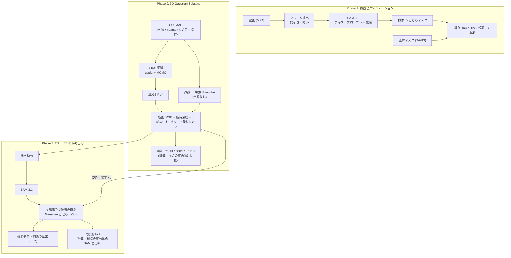
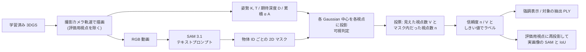

# SpatialSAM Studio — 理論背景・処理フロー・数式

この文書は、SpatialSAM Studio が内部で行っている計算を、理論と数式の面から説明する。
説明はすべて本リポジトリの実装（`src/spatialsam/` 以下）に合わせてある。元の論文と実装が違う点（簡略化した点）は、その都度明記する。

関連文書（測定結果の表はこちらにある。この文書では主な数値だけを引用する）:

- 設計方針: [spatialsam_design.md](spatialsam_design.md)
- SAM 3.1 の実機ベンチマーク・チャンク分割: [benchmark_sam31.md](benchmark_sam31.md)
- 実画像 vs 3DGS 描画の比較: [render_vs_real.md](render_vs_real.md)
- 2D → 3D の持ち上げ結果: [segmentation3d.md](segmentation3d.md)
- 進捗: [todo.md](todo.md)

---

## 目次

1. [目的と全体像](#1-目的と全体像)
2. [記号と座標系の約束](#2-記号と座標系の約束)
3. [テキスト指定の動画セグメンテーション](#3-テキスト指定の動画セグメンテーション)
4. [2D セグメンテーションの評価指標](#4-2d-セグメンテーションの評価指標)
5. [3D Gaussian Splatting の理論](#5-3d-gaussian-splatting-の理論)
6. [3DGS の学習](#6-3dgs-の学習)
7. [カメラと軌道](#7-カメラと軌道)
8. [2D マスクの 3D への持ち上げ](#8-2d-マスクの-3d-への持ち上げ)
9. [システム構成](#9-システム構成)
10. [主な結果と既知の限界](#10-主な結果と既知の限界)
11. [参考文献](#11-参考文献)

---

## 1. 目的と全体像

SpatialSAM Studio は、**テキストで指定した物体を、2D の動画と 3D シーンの両方で切り出し、その精度を測る**ための Streamlit アプリである。
処理はすべてローカル GPU（RTX A1000 8GB）で行い、モデルはオープンウェイトのもの（SAM 3.1 = `facebook/sam3.1`、3DGS は gsplat）だけを使う。

開発は 3 つのフェーズに分かれている。

| フェーズ | 内容 | 主なモジュール |
|---|---|---|
| Phase 1 | テキスト指定の動画セグメンテーションと評価 | `models/`, `pipeline/segmentation.py`, `evaluation/segmentation.py` |
| Phase 2 | 3D Gaussian Splatting の学習・描画、実画像との比較 | `spatial/`, `training/`, `pipeline/rendering.py`, `pipeline/comparison.py` |
| Phase 3 | SAM の 2D マスクを 3D（Gaussian）に持ち上げる | `spatial/mask_lifting.py`, `pipeline/lifting.py`, `evaluation/geometry.py` |

全体の流れを図にする。

---

## 2. 記号と座標系の約束

### 2.1 座標系

- **world 座標系**: COLMAP の再構成座標系。3DGS もこの座標系で学習・保存される（`spatial/colmap.py`）。
- **カメラ座標系**: OpenCV 規約。$x$ 軸が画像の右、$y$ 軸が画像の下、$z$ 軸が前方（視線方向）（`spatial/camera.py`）。
- **画像座標**: 画素 $(c, r)$（列・行）は連続座標の区間 $[c, c+1) \times [r, r+1)$ を占め、**画素中心は $(c + 0.5,\ r + 0.5)$** とする。gsplat も同じ約束で描画する。

### 2.2 外部パラメータ

world からカメラへの剛体変換を $4 \times 4$ 行列で表す（コードでは `Camera.world_to_cam`）。

$$
T_{\mathrm{cam}\leftarrow\mathrm{world}} =
\begin{bmatrix} R & \mathbf{t} \\ \mathbf{0}^\top & 1 \end{bmatrix},
\qquad
\mathbf{x}_{\mathrm{cam}} = R\,\mathbf{x}_{\mathrm{world}} + \mathbf{t}
$$

逆変換 $T_{\mathrm{world}\leftarrow\mathrm{cam}} = T_{\mathrm{cam}\leftarrow\mathrm{world}}^{-1}$（`Camera.cam_to_world`）の並進成分がカメラ中心 $\mathbf{o} = -R^\top \mathbf{t}$（`Camera.position`）になる。
$T_{\mathrm{world}\leftarrow\mathrm{cam}}$ の第 3 列の回転成分 $\mathbf{d} = R^\top \mathbf{e}_z$ が光軸（視線）の向き、第 2 列 $R^\top \mathbf{e}_y$ が「画像の下」の向きである。

### 2.3 内部パラメータ

ピンホールカメラの内部行列（`spatial/camera.py` の `intrinsics`）:

$$
K = \begin{bmatrix} f_x & 0 & c_x \\ 0 & f_y & c_y \\ 0 & 0 & 1 \end{bmatrix}
$$

カメラ座標の点 $(x, y, z)$ は次の画像座標に写る（`spatial/mask_lifting.py` の `project`）。

$$
u = f_x \frac{x}{z} + c_x, \qquad v = f_y \frac{y}{z} + c_y
$$

### 2.4 主な記号

| 記号 | 意味 |
|---|---|
| $N$ | Gaussian の数 |
| $\boldsymbol{\mu}_i \in \mathbb{R}^3$ | $i$ 番目の Gaussian の中心（world） |
| $\mathbf{q}_i$ | 回転の四元数 $(w, x, y, z)$ |
| $\mathbf{s}_i$ | 対数スケール（3 軸） |
| $\Sigma_i$ | 3D 共分散行列 |
| $o_i$ | 不透明度（$[0, 1]$） |
| $\alpha_i$ | ある画素での $i$ 番目の Gaussian の寄与（不透明度） |
| $T_i$ | 透過率（その Gaussian より手前で吸収されずに残る割合） |
| $M_t$ | フレーム $t$ の予測マスク（2 値） |
| $G_t$ | フレーム $t$ の正解マスク |

---

## 3. テキスト指定の動画セグメンテーション

### 3.1 SAM 3.1 の概要

SAM 3 は、名詞句などの**テキストの「概念」で指定した物体を、画像・動画中から全部見つけて分割し、動画では追跡する**モデルである（Promptable Concept Segmentation）。
SAM 2 の「点や箱で指定した 1 つの物体を追跡する」機能に、テキストで指定した概念の検出器を組み合わせたもので、検出器と追跡器が画像エンコーダを共有する構成になっている。
SAM 3.1（Object Multiplex）は、複数の物体の追跡をまとめて効率よく処理するように改良した版である。

本リポジトリではモデルの内部には手を入れず、公式実装（`facebookresearch/sam3`）の `build_sam3_multiplex_video_predictor` をそのまま使う。
アダプタは `src/spatialsam/models/sam31_segmenter.py` の `Sam31Segmenter` で、処理は次の 4 段である。

1. `start_session`: フレームの JPEG 連番（`00000.jpg` から）のディレクトリを渡してセッションを開く。
2. `add_prompt`: **フレーム 0** にテキストプロンプトを付ける。
3. `propagate_in_video`（`propagation_direction="forward"`）: 動画全体に前向きに伝播し、フレームごとに `out_obj_ids` / `out_binary_masks` / `out_probs` を受け取る。
4. **逆向きの補完**: 最初に物体が出たフレーム $f_0$ が 0 より後なら、同じセッションで $f_0$ から `"backward"` に伝播し、$t < f_0$ のフレームだけを置き換える（`backfill`、#30）。

出力は `convert_frame_output` で「物体 ID → 2 値マスク」と「物体 ID → スコア」に正規化される。マスクが空の物体はそのフレームから除く。
テキストで指定すると「その種類の物体すべて」が対象になるので、1 つのプロンプトから複数の物体 ID が出ることがある（例: DAVIS camel で 2 頭目も検出される）。

主な設定（`configs/model.yaml` の `sam31` と `Sam31Settings`）:

| 設定 | 既定値 | 意味 |
|---|---|---|
| `max_num_objects` | 16 | 同時に追跡する物体数の上限 |
| `score_threshold` | 0.5 | 出力する物体の確率のしきい値（`default_output_prob_thresh`） |
| `use_fa3` | false | FlashAttention 3 は Hopper 専用なので Ampere（A1000）では使わない |

> **逆向きの補完が要る理由**: SAM 3.1 は、プロンプトを付けたフレームで物体を検出できないことがある（bonsai では `add_prompt` の応答の時点で空だった）。
> 連続検出で確認できるまで出力しない仕組み（masklet confirmation / hotstart）もあり、追跡は数フレーム後から始まる。
> 追跡が始まったフレームから逆向きにたどれば、追跡器の記憶（memory）を使ってそれ以前のフレームも分割できる。
> 逆向きの結果には検出スコアが無い（sam3 は $-10^4$ を返す）ので、スコアは NaN として扱う。
> 前向きで検出されたフレームの結果は変えない。bonsai ではマスクの無いフレームが 1〜4 → 0 になり、補完したフレームの精度も前向きと同じ水準だった（[benchmark_sam31.md](benchmark_sam31.md)）。

### 3.2 8GB VRAM のための省メモリ設定

公式の既定は H100 を想定しているため、8GB の GPU に載せるために次の設定を加えている（`apply_memory_settings`）。

| 設定 | 既定値 | 効果 |
|---|---|---|
| `grounding_batch_size` / `postprocess_batch_size` | 1（公式は 16） | 画像エンコーダと後処理に一度に通すフレーム数。16 では OOM（#2） |
| `bf16_backbone` | true | 画像・テキストエンコーダ（パラメータの約 94%）だけ bfloat16 にする。重み 3.7GB → 2.1GB |
| `offload_video_to_cpu` | true | デコード済みフレームを CPU メモリに置く |

bf16 化による精度の差は、fp32 と同じフレームで比べた予測マスク同士の IoU が平均 0.998 以上で、実質ゼロだった（[benchmark_sam31.md](benchmark_sam31.md)）。

**OOM 時の自動リトライ**（`pipeline/retry.py` の `OomRetryPolicy`、`pipeline/segmentation.py` の `segment_with_retry`）:
CUDA の OOM が起きたら、キャッシュを解放し、フレーム数を半分にして再実行する。

$$
F_{k+1} = \max\left(F_{\min},\ \left\lfloor F_k / 2 \right\rfloor\right), \qquad F_{\min} = 8,\ \text{最大 } 2 \text{ 回}
$$

解像度ではなくフレーム数を減らすのは、SAM 3.1 が内部で入力を 1008px に変換するため、入力解像度を下げてもメモリが減らないからである。縮小した試行は `metadata.json` の `oom_retries` に記録される。

### 3.3 長い動画のチャンク分割と物体 ID の対応付け

SAM 3.1 の Peak VRAM はフレーム数にほぼ比例して増える（100 フレームで約 4.7GB）。
そこで長い動画は**重なり付きのチャンク**に分けて別々のセッションで推論し、物体 ID をあとからつなぐ（`src/spatialsam/models/chunking.py`）。
`ChunkedSegmenter` は `VideoSegmenter` を包むだけなので、SAM 3.1 以外のセグメンタにも使える。

#### チャンクの区切り方

チャンク長 $L$（`chunk_size`、既定 200）、重なり $O$（`overlap`、既定 48）とすると、ステップは $S = L - O = 152$ で、

$$
\mathcal{C}_k = [\,kS,\ \min(kS + L,\ F)\,), \qquad k = 0, 1, \dots
$$

を、開始位置 $kS$ が $kS + O < F$ を満たす間、かつ末尾 $F$ に届くまで並べる（`chunk_ranges`）。$F \le L$ なら分割しない。
例えば $F = 720$ なら開始位置は 0, 152, 304, 456, 608 の 5 チャンク（境界 4 か所）になる。

#### 重なりフレームでの IoU 行列

チャンクごとに別セッションなので、物体 ID はチャンクごとにばらばらになる。
前のチャンク（つないだ結果）の物体 $p$ と、次のチャンクの物体 $q$ について、重なりフレームの集合 $\mathcal{O}$ 全体で面積を足し合わせた IoU を求める（`overlap_iou`）。

$$
\mathrm{IoU}_{pq} = \frac{\sum_{f \in \mathcal{O}} \left| A_{p,f} \cap B_{q,f} \right|}{\sum_{f \in \mathcal{O}} \left| A_{p,f} \cup B_{q,f} \right|}
$$

ここで $A_{p,f}$、$B_{q,f}$ はフレーム $f$ のマスク（そのフレームに無ければ空集合）。片方にしかマスクが無いフレームは、分母にだけその面積が加わる。
フレームごとの IoU を平均するのではなく**面積で重み付け**しているので、小さく写ったフレームの影響は小さくなる。

#### ハンガリアン法による 1 対 1 の対応付け

IoU 行列 $\mathbf{C} \in [0,1]^{P \times Q}$ に対し、対応の IoU の和が最大になる 1 対 1 の割り当てを求める（線形割当問題）。

$$
\max_{\pi} \sum_{(p, q) \in \pi} \mathrm{IoU}_{pq}
\quad \text{s.t. 各 } p, q \text{ は高々 1 回しか現れない}
$$

実装は `scipy.optimize.linear_sum_assignment(-IoU)`（コスト最小化なので符号を反転）である（`match_ids`）。
得られた対のうち $\mathrm{IoU}_{pq} \ge 0.3$（`match_iou`）のものだけを採用し、次のチャンクの ID $q$ を前の ID $p$ に付け替える。対応の取れなかった物体には新しい ID を振る。
貪欲法（IoU の大きい順に取る）と違い、全体として最適な割り当てになる。

#### 重なりフレームの結果の選び方

重なりフレームでは、追跡の履歴が長い**前のチャンクの結果を残す**。前のチャンクにマスクが無いフレームだけ、次のチャンクの結果で埋める（`Stitcher.add`）。

#### 重なりの長さの決め方

SAM 3.1 は新しいセッションで、連続検出で確認できるまで物体を出力しない（数〜数十フレームの遅れ）。
重なりがこの遅れより短いと、次のチャンクの物体が重なりの中に現れず、対応が取れずに ID が途切れる。
実測では重なり 8 では ID が 3 つに分かれ、48（既定）では 1 つにつながった（[benchmark_sam31.md](benchmark_sam31.md)）。
計算量は重なりの分だけ増え、200 / 48 で約 $L / S = 200/152 \approx 1.3$ 倍になる。

---

## 4. 2D セグメンテーションの評価指標

実装は `src/spatialsam/evaluation/segmentation.py`。各フレームで予測マスク $M$ と正解マスク $G$ を比べ、フレーム平均を取る。

> **簡略化**: 予測は「全物体マスクの和集合」、正解は「GT の前景」として比べる。DAVIS の多物体評価のような物体 ID ごとの対応付けは行わない（`FrameMasks.union`、`pipeline/evaluation.py`）。
> 物体が検出されなかったフレームは空マスクとして評価する。

### 4.1 IoU（Jaccard 指数、$\mathcal{J}$）

$$
\mathcal{J}(M, G) = \frac{|M \cap G|}{|M \cup G|}
$$

$M$ も $G$ も空のとき（分母 0）は 1 とする（`_ratio` の `empty=1.0`）。

### 4.2 Dice 係数

$$
\mathrm{Dice}(M, G) = \frac{2\,|M \cap G|}{|M| + |G|}
$$

Dice と IoU は単調な関係 $\mathrm{Dice} = 2\mathcal{J} / (1 + \mathcal{J})$ にあり、順位は変わらない。参考値として出している。

### 4.3 輪郭 F 値（$\mathcal{F}$）

領域の重なりでは測りにくい「輪郭の正確さ」を測る。

1. **輪郭の抽出**（`boundary_map`）: マスクから $3 \times 3$ の収縮（erosion）を引いた 1 画素幅の輪郭 $\partial M$ を作る。画像の外側は 0 とみなすので、画像の縁に接した部分も輪郭になる。
2. **許容距離**（`boundary_tolerance`）: DAVIS と同じく画像の対角長の 0.008 倍を切り上げる。
   $$
   r = \max\left(1,\ \left\lceil 0.008 \sqrt{H^2 + W^2} \right\rceil\right)
   $$
   854×480 なら $\sqrt{854^2 + 480^2} \approx 979.7$ なので $r = \lceil 7.84 \rceil = 8$ 画素。
3. **適合率と再現率**: 半径 $r$ の円形（楕円カーネル）で膨張した輪郭 $D_r(\cdot)$ を使う。
   $$
   P = \frac{|\partial M \cap D_r(\partial G)|}{|\partial M|}, \qquad
   R = \frac{|\partial G \cap D_r(\partial M)|}{|\partial G|}, \qquad
   \mathcal{F} = \frac{2PR}{P + R}
   $$

両方の輪郭が空なら 1、片方だけ空なら 0 とする。

> **簡略化**: DAVIS 公式の評価コードは輪郭を細線化（thinning）して距離で照合するが、本実装は「収縮との差」と「膨張」による近似である。値は近いが厳密には一致しない。

### 4.4 J&F

$\mathcal{J}$ と $\mathcal{F}$ をそれぞれ全フレームで平均してから、その平均を取る（`summarize`）。

$$
\bar{\mathcal{J}} = \frac{1}{|\mathcal{T}|}\sum_{t \in \mathcal{T}} \mathcal{J}(M_t, G_t), \qquad
\bar{\mathcal{F}} = \frac{1}{|\mathcal{T}|}\sum_{t \in \mathcal{T}} \mathcal{F}(M_t, G_t), \qquad
\mathcal{J}\&\mathcal{F} = \frac{\bar{\mathcal{J}} + \bar{\mathcal{F}}}{2}
$$

$\mathcal{T}$ は推論したフレームのうち GT のあるフレームの集合。DAVIS 2017 の単一物体 6 本で J&F 0.95〜0.97 だった（[benchmark_sam31.md](benchmark_sam31.md)）。

---

## 5. 3D Gaussian Splatting の理論

3D Gaussian Splatting（3DGS）は、シーンを多数の 3D ガウス分布（楕円体のぼかし）の集まりで表し、それを画像平面に投影して前から順に重ねることで画像を描く手法である。
描画が微分可能なので、実画像との誤差から各 Gaussian のパラメータを勾配法で学習できる。描画（ラスタライズ）には gsplat（`gsplat.rasterization`）を使う。

### 5.1 パラメータ化

1 つの Gaussian は次のパラメータを持つ（`spatial/gaussians.py` の `GaussianScene`）。
最適化しやすいよう、制約のある量は**活性化前の値**で持ち、使うときに変換する（`spatial/renderer.py` の `GaussianTensors`）。

| パラメータ | 保存する値 | 使う値 | 変換 |
|---|---|---|---|
| 中心 | $\boldsymbol{\mu} \in \mathbb{R}^3$ | 同じ | — |
| 回転 | $\mathbf{q} \in \mathbb{R}^4$（未正規化） | 単位四元数 | $\hat{\mathbf{q}} = \mathbf{q} / \lVert \mathbf{q} \rVert$ |
| 大きさ | 対数スケール $\mathbf{s} \in \mathbb{R}^3$ | $\boldsymbol{\sigma} = e^{\mathbf{s}} > 0$ | 指数 |
| 不透明度 | ロジット $\ell \in \mathbb{R}$ | $o \in (0, 1)$ | $o = \mathrm{sigmoid}(\ell) = 1 / (1 + e^{-\ell})$ |
| 色 | SH 係数 $\mathbf{k} \in \mathbb{R}^{(D+1)^2 \times 3}$ | 視点依存の RGB | §5.6 |

PLY ファイルは INRIA の 3DGS 実装と同じ形式で、上の「保存する値」をそのまま書く（`f_dc_*`、`f_rest_*`、`opacity`、`scale_*`、`rot_*`）。`f_rest_*` はチャンネル優先（R の高次係数 → G → B）で並ぶ。

### 5.2 共分散行列

正規化した四元数 $\hat{\mathbf{q}} = (w, x, y, z)$ から回転行列を作る（`spatial/colmap.py` の `quat_to_rotation` と同じ式）。

$$
R(\hat{\mathbf{q}}) =
\begin{bmatrix}
1 - 2(y^2 + z^2) & 2(xy - wz) & 2(xz + wy) \\
2(xy + wz) & 1 - 2(x^2 + z^2) & 2(yz - wx) \\
2(xz - wy) & 2(yz + wx) & 1 - 2(x^2 + y^2)
\end{bmatrix}
$$

スケール行列 $S = \mathrm{diag}(\sigma_1, \sigma_2, \sigma_3)$ と合わせて、3D 共分散は

$$
\Sigma = R\,S\,S^\top R^\top
$$

と表す。この形にすると、勾配法でどう更新しても $\Sigma$ は常に半正定値（実際には正定値）に保たれる。
Gaussian の密度（正規化しない形）は $G(\mathbf{x}) = \exp\!\left(-\tfrac12 (\mathbf{x} - \boldsymbol{\mu})^\top \Sigma^{-1} (\mathbf{x} - \boldsymbol{\mu})\right)$ である。

### 5.3 画像平面への投影（EWA splatting）

透視投影は非線形なので、Gaussian を投影したものは厳密には Gaussian にならない。
そこで EWA splatting（Zwicker et al.）と同じく、Gaussian の中心のまわりで投影を 1 次近似（局所アフィン近似）する。

カメラ座標での中心を $\mathbf{t} = W \boldsymbol{\mu} + \mathbf{t}_{\mathrm{cw}} = (t_x, t_y, t_z)$（$W$ は world_to_cam の回転部分）とすると、投影 $(u, v) = (f_x t_x / t_z + c_x,\ f_y t_y / t_z + c_y)$ のヤコビアンは

$$
J = \begin{bmatrix}
f_x / t_z & 0 & -f_x t_x / t_z^2 \\
0 & f_y / t_z & -f_y t_y / t_z^2
\end{bmatrix}
$$

で、画像平面での $2 \times 2$ 共分散は

$$
\Sigma' = J\,W\,\Sigma\,W^\top J^\top
$$

になる。gsplat は既定でこれに小さな値 $\varepsilon I$（`eps2d = 0.3`）を足し、1 画素より小さい Gaussian が消えたりちらついたりするのを防ぐ（低域フィルタ）。
投影した中心は $\boldsymbol{\mu}' = (u, v)$。近すぎる・遠すぎる Gaussian は描かない（本リポジトリの設定は `near_plane = 0.01`、`far_plane = 1e10`。`spatial/renderer.py` の `RenderSettings`）。

### 5.4 α 合成

画素 $\mathbf{p}$ での $i$ 番目の Gaussian の寄与は

$$
\alpha_i(\mathbf{p}) = o_i \exp\!\left(-\tfrac12 (\mathbf{p} - \boldsymbol{\mu}'_i)^\top \Sigma'^{-1}_i (\mathbf{p} - \boldsymbol{\mu}'_i)\right)
$$

である（gsplat 1.5.3 の CUDA カーネルでは $\alpha_i$ を 0.999 で頭打ちにし、$1/255$ 未満の寄与は無視する。INRIA の元実装の頭打ちは 0.99）。
画素に重なる Gaussian を**カメラから近い順**に並べ、前から順に合成する。

$$
C(\mathbf{p}) = \sum_{i=1}^{n} \mathbf{c}_i\, \alpha_i \, T_i,
\qquad
T_i = \prod_{j=1}^{i-1} (1 - \alpha_j)
$$

$T_i$ は透過率で、$i$ 番目より手前の Gaussian に吸収されずに残った光の割合を表す。これは NeRF の体積レンダリング（離散化した放射輝度場の積分）と同じ形である。
累積不透明度は

$$
A(\mathbf{p}) = \sum_{i} \alpha_i T_i = 1 - \prod_{i} (1 - \alpha_i)
$$

で、gsplat の 2 番目の戻り値（`alphas`）にあたる。背景色 $\mathbf{b}$ は自前で合成する（`composite`。gsplat 1.5.3 は `packed=True` で `backgrounds` を渡すと形状チェックで落ちるため）。

$$
C_{\mathrm{out}}(\mathbf{p}) = C(\mathbf{p}) + \bigl(1 - A(\mathbf{p})\bigr)\,\mathbf{b}
$$

既定の背景は黒（$\mathbf{b} = \mathbf{0}$）。gsplat は画像を $16 \times 16$ のタイルに分け、タイルごとに Gaussian を深さで並べて並列に合成する。

### 5.5 期待深度（RGB+ED）

描画は `render_mode="RGB+ED"` で行い、色と同時に**期待深度**（Expected Depth）を得る。各 Gaussian の「色」の代わりにカメラ $z$（中心の深さ $z_i$）を合成し、累積不透明度で正規化したものである。

$$
D(\mathbf{p}) = \frac{\sum_i z_i\, \alpha_i T_i}{\sum_i \alpha_i T_i} = \frac{\sum_i z_i\, \alpha_i T_i}{A(\mathbf{p})}
$$

gsplat の "ED" は既に $A$ で割ってある。本実装（`expected_depth`）は $A \le 10^{-6}$ の画素を 0 にそろえる。
$A$ が小さい画素（ほとんど何も写っていない画素）の深度は当てにならないので、後段の処理では $A \ge 0.5$ の画素だけを使う（`RenderOutput.valid_depth`、`pipeline/rendering.py` の `MIN_ALPHA = 0.5`）。

> 期待深度は「重み付き平均」なので、前景と背景の境界の画素では両者の中間の、実在しない深さになることがある。§8 の可視判定に許容幅を設けている理由の 1 つである。

### 5.6 球面調和関数（SH）による視点依存の色

光沢や照明による見え方の違いを表すため、Gaussian の色を**見る方向 $\mathbf{d}$ の関数**として、次数 $D$ までの実球面調和関数 $Y_{lm}$ の線形結合で表す。

$$
\mathbf{c}(\mathbf{d}) = \sum_{l=0}^{D} \sum_{m=-l}^{l} \mathbf{k}_{lm}\, Y_{lm}(\mathbf{d}) + 0.5,
\qquad
\mathbf{d} = \frac{\boldsymbol{\mu} - \mathbf{o}}{\lVert \boldsymbol{\mu} - \mathbf{o} \rVert}
$$

係数の数は $(D+1)^2$（$D = 3$ なら 16。`sh_degree_from_coeffs`）で、0 番目（$l = 0$）が視点によらない DC 成分である。
gsplat は SH の評価結果に **0.5 を足し**、負の値を 0 に切って色にする（INRIA 実装と同じ）。

0 次の関数は定数 $Y_{00} = \dfrac{1}{2\sqrt{\pi}} \approx 0.28209479$（`spatial/pointcloud.py` の `SH_C0`）なので、DC 成分と RGB（$[0,1]$）は次の式で相互に変換できる。

$$
\mathbf{c} = \mathrm{SH\_C0} \cdot \mathbf{k}_{00} + 0.5
\quad\Longleftrightarrow\quad
\mathbf{k}_{00} = \frac{\mathbf{c} - 0.5}{\mathrm{SH\_C0}}
$$

これは点群の色から初期値を作るとき（`rgb_to_sh0`）と、対象以外を暗くする強調表示（`spatial/scene_highlight.py` の `dim_others`）で使っている。

### 5.7 点群からの Gaussian（学習しない描画）

COLMAP の点群や普通の点群 PLY は、学習せずにそのまま Gaussian にして描くこともできる（`spatial/pointcloud.py` の `gaussians_from_points`）。

- 中心: 点の座標。回転: 単位四元数 $(1, 0, 0, 0)$。SH: 次数 0（点の色から DC 成分を作る）。
- 不透明度: $o = 0.9$（ロジットは $\log(0.9/0.1)$）。
- 大きさ: **等方的**（3 軸同じ）にし、近い 3 点までの平均距離を使う（`neighbor_distances`、`scipy.spatial.cKDTree`）。

$$
\bar{d}_i = \frac{1}{3}\sum_{j \in \mathrm{kNN}_3(i)} \lVert \mathbf{x}_i - \mathbf{x}_j \rVert,
\qquad
\sigma_i = \min\!\left(\max(\bar{d}_i, 10^{-7}),\ \mathrm{median}_j\, \bar{d}_j\right)
$$

疎な領域の点は $\bar{d}_i$ が非常に大きく（bonsai で最大 45）、カメラの手前で視野を覆うぼけになるため、**中央値で頭打ち**にしている（`clip_outlier_scales`）。0.5 / 0.75 / 0.9 分位を見比べて、中央値が最も見た目が良かった。

> 学習していないので隙間やぼけが残り、画質も SAM の結果も学習済み 3DGS に大きく劣る（§10）。比較の基準線として使う。

---

## 6. 3DGS の学習

実装は `src/spatialsam/training/trainer.py`（学習ループ）、`training/losses.py`（損失と指標）、`training/dataset.py`（データ）。
ハイパーパラメータは gsplat の `examples/simple_trainer.py` の MCMC 設定に合わせている。既定値は `TrainConfig` を参照。

### 6.1 データと評価用視点

COLMAP の `cameras.bin` / `images.bin` / `points3D.bin` を読み、画像を**画像名順**に並べる。
Mip-NeRF 360 の慣例に従い、**8 枚に 1 枚**（添字 $i \equiv 0 \pmod 8$、つまり 0, 8, 16, …）を評価用（hold-out）に除き、学習には使わない（`HOLDOUT_EVERY = 8`、`split_views`）。
評価用視点は「学習で見ていない新しい視点」なので、新規視点の描画品質（§6.6）と 2D → 3D の持ち上げの評価（§8.6）に使う。

縮小画像（例: `images_4`）で学習する場合は、読み込んだ画像の実サイズに合わせて内部行列を縮める（§7.2）。

**シーンの大きさ**（`ColmapDataset.scene_scale`）: カメラ中心 $\mathbf{o}_k$ の重心からの最大距離の 1.1 倍。

$$
s_{\mathrm{scene}} = 1.1 \cdot \max_k \left\lVert \mathbf{o}_k - \bar{\mathbf{o}} \right\rVert
$$

### 6.2 初期化

COLMAP の点群から初期 Gaussian を作る（`init_params`）。§5.7 との違いは次の点である。

| 項目 | 学習の初期値 | §5.7（学習しない描画） |
|---|---|---|
| 大きさ | $\log(0.1 \cdot \bar{d}_i)$（`init_scale = 0.1`、中央値での頭打ちなし） | $\min(\bar{d}_i, \mathrm{median})$ |
| 不透明度 | 0.5（`init_opacity`） | 0.9 |
| 回転 | 一様乱数 $[0,1)^4$（描画時に正規化） | 単位四元数 |
| SH | DC は点の色、高次（15 係数 × 3）は 0 | DC のみ |

### 6.3 損失関数

3DGS の標準の損失（`photometric_loss`）に、MCMC 論文の正則化（`Trainer.regularization`）を加える。

$$
\mathcal{L} = (1 - \lambda)\,\mathcal{L}_1 + \lambda\,\bigl(1 - \mathrm{SSIM}(\hat{I}, I)\bigr)
+ \lambda_o \cdot \frac{1}{N}\sum_{i} o_i
+ \lambda_\sigma \cdot \frac{1}{3N}\sum_{i}\sum_{a=1}^{3} \sigma_{i,a}
$$

$$
\mathcal{L}_1 = \frac{1}{3HW}\sum_{\mathbf{p}, c} \left| \hat{I}_c(\mathbf{p}) - I_c(\mathbf{p}) \right|
$$

既定値は $\lambda = 0.2$（`ssim_weight`）、$\lambda_o = 0.01$（`opacity_reg`）、$\lambda_\sigma = 0.01$（`scale_reg`）。画像の値域は $[0, 1]$ で、描画結果は $[0, 1]$ に切ってから比べる。

- L1 は色の誤差を、SSIM 項は局所的な構造（エッジやテクスチャ）の誤差を担う。
- 正則化は不透明度と大きさを小さく保つ。不要な Gaussian の不透明度が下がり、後述の再配置（§6.4）の対象になりやすくなる。

> **簡略化**: MCMC 論文の正則化は不透明度の L1 と共分散の固有値の平方根（= スケール）の L1 の**和**だが、本実装は（gsplat の simple_trainer と同様に）**平均**を取っている。$N$ が変わっても重みの意味が変わらない利点がある。

#### SSIM

SSIM（Wang et al. 2004）は、局所領域の輝度・コントラスト・構造の類似度を掛け合わせた指標である。
3DGS 論文と同じく $11 \times 11$、$\sigma = 1.5$ の正規化ガウス窓 $w$ を使う（`SSIM_WINDOW = 11`、`SSIM_SIGMA = 1.5`）。窓による局所平均を $\langle \cdot \rangle_w$ と書くと、

$$
\mu_x = \langle x \rangle_w,\quad
\sigma_x^2 = \langle x^2 \rangle_w - \mu_x^2,\quad
\sigma_{xy} = \langle xy \rangle_w - \mu_x \mu_y
$$

$$
\mathrm{SSIM}(x, y) = \frac{(2\mu_x\mu_y + C_1)(2\sigma_{xy} + C_2)}{(\mu_x^2 + \mu_y^2 + C_1)(\sigma_x^2 + \sigma_y^2 + C_2)},
\qquad C_1 = (0.01)^2,\ C_2 = (0.03)^2
$$

（値域 $[0, 1]$ なのでダイナミックレンジ $L = 1$。）これを画素ごと・チャンネルごとに求め、画像全体で平均する。窓の畳み込みは 0 埋めで行うので、画像の縁では公式実装と少し値が違う。

### 6.4 MCMC 戦略による Gaussian の増減

元の 3DGS は、勾配の大きさに基づくヒューリスティック（複製・分割・刈り込み）で Gaussian の数を調整する。
3DGS-MCMC（Kheradmand et al. 2024）は、Gaussian の集合を確率分布からのサンプルとみなし、学習の更新を**確率的勾配ランジュバン力学（SGLD）**として解釈し直す。
本リポジトリは gsplat の `MCMCStrategy` をそのまま使う（`Trainer.__init__`、`train_step` の `step_post_backward`）。主な仕組みは次の 3 つ。

1. **再配置（relocation）**: 不透明度が非常に小さい（gsplat の既定 `min_opacity = 0.005` 以下の）「死んだ」Gaussian を、生きている Gaussian の位置に移す（不透明度に比例した確率でサンプル）。
   移したあとも描画結果がほぼ変わらないよう、移動先の Gaussian と合わせて不透明度とスケールを補正する。Gaussian の総数は変わらない。
2. **追加**: 一定間隔で Gaussian を 5% ずつ増やし（$N \leftarrow \min(\texttt{cap\_max},\ \lfloor 1.05 N \rfloor)$）、総数を上限 `cap_max` まで伸ばす。新しい Gaussian も同様に不透明度に応じてサンプルした位置に置く。
3. **ノイズの注入**: 中心 $\boldsymbol{\mu}$ に、共分散 $\Sigma$ の形をしたノイズを加える。不透明度が低い Gaussian ほど大きく動き、探索が進む。gsplat の実装では概ね
   $$
   \Delta\boldsymbol{\mu} = \eta_{\mathrm{noise}} \cdot \eta_t \cdot \mathrm{sigmoid}\bigl(-k\,(o - t_0)\bigr) \cdot \Sigma\,\boldsymbol{\epsilon},
   \qquad \boldsymbol{\epsilon} \sim \mathcal{N}(\mathbf{0}, I)
   $$
   の形で、$\eta_t$ は中心の現在の学習率、$\eta_{\mathrm{noise}}$ は `noise_lr`（既定 $5 \times 10^5$）、$k = 100$、$t_0 = 0.005$ である。

設定（`TrainConfig`）:

| 設定 | 既定値 | 意味 |
|---|---|---|
| `cap_max` | 500,000（UI と `scripts/train_3dgs.py` の既定は 1,000,000） | Gaussian 数の上限。8GB の VRAM に収めるための頭打ち |
| `refine_start` / `refine_stop` / `refine_every` | 500 / 25,000 / 100 | 再配置・追加を行う step の範囲と間隔。既定の 7,000 step では 500 step 以降ずっと行う |
| `noise_lr` | $5 \times 10^5$ | ノイズの強さ |

描画は `packed=True` で行い、Gaussian と画素の交差の中間バッファを抑えて VRAM を節約する。

### 6.5 最適化と学習率

パラメータごとに 1 つずつ Adam（$\epsilon = 10^{-15}$）を用意する（MCMC 戦略がこれを前提にしているため。`create_optimizers`）。

| パラメータ | 学習率 |
|---|---|
| 中心 `means` | $1.6 \times 10^{-4} \times s_{\mathrm{scene}}$（指数減衰） |
| 対数スケール `scales` | $5 \times 10^{-3}$ |
| 四元数 `quats` | $1 \times 10^{-3}$ |
| 不透明度ロジット `opacities` | $5 \times 10^{-2}$ |
| SH の DC `sh0` | $2.5 \times 10^{-3}$ |
| SH の高次 `shN` | $2.5 \times 10^{-3} / 20 = 1.25 \times 10^{-4}$ |

中心の学習率はシーンの大きさに比例させ（座標の単位に依存しないように）、全 $T$ step で $1/100$ まで指数的に下げる（`ExponentialLR`）。

$$
\eta_t = \eta_0 \cdot \gamma^t, \qquad \gamma = 0.01^{1/T}
\quad\Longrightarrow\quad
\eta_T = 0.01\,\eta_0
$$

**SH 次数のスケジュール**: 最初は DC 成分だけで色を合わせ、1,000 step ごとに次数を 1 つ上げる（`sh_degree_interval`）。

$$
D_t = \min\left(\left\lfloor t / 1000 \right\rfloor,\ 3\right)
$$

視点依存の成分を後から足すことで、形が固まる前に高次の SH が色の誤差を吸収してしまうのを防ぐ。

1 step で 1 視点を使い、エポックごとに学習用視点の順序を混ぜる。既定は 7,000 step。

### 6.6 画質指標（PSNR / SSIM / LPIPS）

実装は `src/spatialsam/evaluation/image_quality.py`。PSNR と SSIM は学習と同じ実装（`training/losses.py`）を使い、学習時の評価値と比べられるようにしている。
いずれも評価用視点（学習に使っていない）で、描画画像と実画像を比べてから視点平均を取る。

**PSNR**（値域 $[0,1]$、MSE は全画素・全チャンネルの平均）:

$$
\mathrm{PSNR} = 10 \log_{10} \frac{1}{\mathrm{MSE}}, \qquad
\mathrm{MSE} = \frac{1}{3HW}\sum_{\mathbf{p}, c} \bigl(\hat{I}_c(\mathbf{p}) - I_c(\mathbf{p})\bigr)^2
$$

**SSIM**: §6.3 と同じ。

**LPIPS**（Zhang et al. 2018）: 学習済みネットワーク（3DGS 論文と同じ AlexNet 版）の各層の特徴を比べる知覚的な距離で、**小さいほど似ている**。
入力は $[-1, 1]$ に変換する。層 $l$ の特徴をチャンネル方向に正規化したもの $\hat{y}^l$、学習済みの重み $\mathbf{w}_l$ を使って

$$
\mathrm{LPIPS}(x, x_0) = \sum_{l} \frac{1}{H_l W_l} \sum_{h, w} \left\lVert \mathbf{w}_l \odot \bigl(\hat{y}^l_{hw} - \hat{y}^l_{0,hw}\bigr) \right\rVert_2^2
$$

である（`lpips.LPIPS(net="alex")`）。

---

## 7. カメラと軌道

### 7.1 COLMAP のカメラ

`src/spatialsam/spatial/colmap.py` は COLMAP の sparse モデル（バイナリ）を直接読む。

- `images.bin` の姿勢 `qvec`（$w, x, y, z$）と `tvec` は **world → cam** の回転と並進で、§2.2 の $R, \mathbf{t}$ そのものである。$R$ は §5.2 の式で作る。
- `cameras.bin` の内部パラメータから $K$ を作る。`SIMPLE_PINHOLE` / `SIMPLE_RADIAL` / `RADIAL` は $f_x = f_y = f$、それ以外は $(f_x, f_y, c_x, c_y)$。
- **歪み係数は無視する**（undistort 済みの PINHOLE 画像を想定。Mip-NeRF 360 のデータはこれに当たる）。魚眼モデルは未対応でエラーにする。
- `points3D.bin` からは座標と色だけを読む（track は読み飛ばす）。

COLMAP も OpenCV と同じカメラ座標系（$x$ 右・$y$ 下・$z$ 前）なので、変換なしで gsplat に渡せる（gsplat の `viewmats` は world → cam、`Ks` はこの $K$）。
3DGS は COLMAP の座標系で学習されるので、COLMAP のカメラで描けば学習に使った実画像と同じ視点になる。

### 7.2 縮小画像に合わせた内部行列

画像を $W \times H$ から $W' \times H'$ に縮めたとき、縦横の倍率 $s_x = W'/W$、$s_y = H'/H$ を別々に掛ける（`Camera.resized`）。

$$
K' = \begin{bmatrix} s_x f_x & 0 & s_x c_x \\ 0 & s_y f_y & s_y c_y \\ 0 & 0 & 1 \end{bmatrix}
$$

これは画像の左上隅を原点とする連続座標で拡大縮小した場合の厳密な式である（画素中心を $+0.5$ とする §2.1 の約束と整合する）。
SAM の入力解像度に合わせて縮めるとき（`fit_max_side`）は、H.264（yuv420p）が奇数サイズを書けないので縦横を偶数にそろえる。比較で実画像を偶数サイズにするときは右端・下端を 1 画素切るだけなので、$K$ は変えない（`pipeline/comparison.py` の `crop_even`）。

### 7.3 視野角からの内部行列とオービット

COLMAP のカメラが無いオービットでは、縦の視野角 $\theta_y$ から内部行列を作る（`intrinsics_from_fov`）。

$$
f_x = f_y = \frac{H/2}{\tan(\theta_y / 2)}, \qquad c_x = \frac{W}{2},\ c_y = \frac{H}{2}
$$

既定は $\theta_y = 50^\circ$、$854 \times 480$、120 フレーム、仰角 $20^\circ$（`OrbitSpec`）。

**look_at**（`spatial/camera.py`）: 位置 $\mathbf{e}$ から注視点 $\mathbf{c}$ を見るカメラを、上方向 $\mathbf{u}_{\mathrm{up}}$ に画像の上がそろうように作る。

$$
\mathbf{f} = \frac{\mathbf{c} - \mathbf{e}}{\lVert \mathbf{c} - \mathbf{e} \rVert},\qquad
\mathbf{r} = \frac{\mathbf{f} \times \mathbf{u}_{\mathrm{up}}}{\lVert \mathbf{f} \times \mathbf{u}_{\mathrm{up}} \rVert},\qquad
\mathbf{b} = \mathbf{f} \times \mathbf{r}
$$

$$
R = \begin{bmatrix} \mathbf{r}^\top \\ \mathbf{b}^\top \\ \mathbf{f}^\top \end{bmatrix},\qquad
\mathbf{t} = -R\,\mathbf{e}
$$

$R$ の各行はカメラの $x$（右）・$y$（下）・$z$（前）軸を world 座標で表したもの。$\mathbf{b}$（下）は $\mathbf{u}_{\mathrm{up}}$ のおおむね逆向きになる。$\mathbf{f} \parallel \mathbf{u}_{\mathrm{up}}$ のときは $\mathbf{r}$ が決まらないのでエラーにする。

**オービットの位置**（`orbit_eyes`）: $\mathbf{u}_{\mathrm{up}}$ に直交する 2 軸 $\mathbf{a}, \mathbf{a}'$（`orbit_basis`。$\mathbf{u}_{\mathrm{up}}$ と最も平行でない座標軸との外積で作る）を使い、注視点 $\mathbf{c}$、半径 $\rho$、仰角 $\varphi$ で

$$
\mathbf{e}_k = \mathbf{c} + \rho\left[\cos\varphi\,\bigl(\cos\phi_k\,\mathbf{a} + \sin\phi_k\,\mathbf{a}'\bigr) + \sin\varphi\,\mathbf{u}_{\mathrm{up}}\right],
\qquad \phi_k = \phi_0 + \frac{2\pi k}{K}
$$

とする。

### 7.4 撮影カメラからの注視点の推定（最小二乗）

360° 撮影では、どのカメラも被写体の方を向いている。そこで**全カメラの光軸に最も近い点**を注視点とする（`estimate_look_center`）。

カメラ $k$ の光軸は、中心 $\mathbf{o}_k$ を通り単位ベクトル $\mathbf{d}_k$（cam_to_world の第 3 列）の向きの直線である。
点 $\mathbf{p}$ からこの直線までの距離の 2 乗は、$\mathbf{d}_k$ に直交する成分の長さなので、射影行列 $P_k = I - \mathbf{d}_k \mathbf{d}_k^\top$ を使って

$$
\mathrm{dist}^2(\mathbf{p}, \ell_k) = \left\lVert P_k (\mathbf{p} - \mathbf{o}_k) \right\rVert^2
$$

と書ける。これを全カメラで足した

$$
E(\mathbf{p}) = \sum_k \left\lVert P_k (\mathbf{p} - \mathbf{o}_k) \right\rVert^2
$$

を最小にする。$P_k$ は対称（$P_k^\top = P_k$）かつ冪等（$P_k^2 = P_k$）なので $P_k^\top P_k = P_k$ であり、勾配は

$$
\nabla_{\mathbf{p}} E = 2 \sum_k P_k (\mathbf{p} - \mathbf{o}_k)
$$

になる。これを 0 とおくと**正規方程式**

$$
\left(\sum_k \left(I - \mathbf{d}_k \mathbf{d}_k^\top\right)\right) \mathbf{p} = \sum_k \left(I - \mathbf{d}_k \mathbf{d}_k^\top\right) \mathbf{o}_k
$$

が得られる。左辺の行列は半正定値で、光軸が 2 本以上で互いに平行でなければ正定値になり、解は一意に決まる。
実装では、すべての光軸が平行に近い（退化した）場合にも解が出るよう `np.linalg.lstsq` で解いている。

### 7.5 上方向・半径・仰角の推定

- **上方向**（`estimate_up`）: OpenCV では画像の上は $-y$ 軸なので、各カメラの $-R_k^\top \mathbf{e}_y$ の平均を正規化したものを world の上とする。
  $$
  \mathbf{u}_{\mathrm{up}} = \frac{\sum_k \left(-R_k^\top \mathbf{e}_y\right)}{\left\lVert \sum_k \left(-R_k^\top \mathbf{e}_y\right) \right\rVert}
  $$
  撮影者がカメラをおおむね水平に構えていることを仮定している。
- **半径**: 注視点からカメラ中心までの距離の平均 $\rho = \frac{1}{K}\sum_k \lVert \mathbf{o}_k - \mathbf{c} \rVert$。
- **仰角**: $\varphi = \arcsin\!\left( \frac{1}{\rho} \cdot \frac{1}{K}\sum_k (\mathbf{o}_k - \mathbf{c}) \cdot \mathbf{u}_{\mathrm{up}} \right)$（`orbit_from_cameras`）。

カメラが無い（PLY だけの）場合は、外れ値を除いた中心座標の範囲（2%〜98% 分位）の中心を注視点、範囲の対角長を半径とし、上方向はユーザーが軸を選ぶ（`spatial/scene_source.py` の `orbit_from_bounds`）。

### 7.6 データセット軌道

撮影カメラを画像名順にたどる軌道（`dataset_trajectory`）。実画像と同じ視点になるので比較に使える。
`exclude_holdout_every = 8` を指定すると、学習時の評価用視点（§6.1 と同じ添字規則）を除く。2D → 3D の持ち上げに評価用視点を使わないようにして、評価用視点での再投影 IoU（§8.6）を公平にするためである。

---

## 8. 2D マスクの 3D への持ち上げ

実装は `src/spatialsam/spatial/mask_lifting.py`（計算）、`src/spatialsam/pipeline/lifting.py`（入出力）、`src/spatialsam/evaluation/geometry.py`（評価）。設計は [spatialsam_design.md](spatialsam_design.md) §7。

### 8.1 全体の流れ

SAM はフレームを間引いたり縮小したりして推論するので、`metadata.json` の `frame_indices` で描画フレームとの対応を取り、カメラ（§7.2）と深度・α（最近傍補間）をマスクの解像度に合わせる（`masked_views`）。

### 8.2 逆投影

画素 $(u, v)$ と深度 $z$ から world 座標の 3D 点を求める（`backproject`）。画素中心 $(u + 0.5, v + 0.5)$ を使う。

$$
\mathbf{p}_{\mathrm{world}} = T_{\mathrm{world}\leftarrow\mathrm{cam}}
\begin{bmatrix} z\, K^{-1} (u + 0.5,\ v + 0.5,\ 1)^\top \\ 1 \end{bmatrix}
$$

$K^{-1}(u, v, 1)^\top$ は $z = 1$ の平面上の点（光線の方向）で、深度を掛けるとカメラ座標の点になる。
ここでの深度は期待深度 $D$ が光軸方向の $z$ なので、光線の長さではなく $z$ をそのまま掛ければよい。
この関数は点群へのラベル付け用に実装してあり、Gaussian へのラベル付け（以下）では使わない。

### 8.3 可視判定

Gaussian ごとのラベルは、逆投影ではなく逆向き、つまり **Gaussian の中心 $\boldsymbol{\mu}_i$ を各視点に投影**して決める（`visible_pixels`）。
単純に「マスクの内側に投影されたか」だけを数えると、手前の物体に隠れた Gaussian までラベルされてしまう。そこで、その視点で**実際に見えている**場合だけを数える。

視点 $v$ で中心をカメラ座標に移し、深さ $z_{i}^{v}$ と画素 $(c, r) = (\lfloor u \rfloor, \lfloor v \rfloor)$ を求める。次の条件をすべて満たすとき「見えている」とする。

$$
z_i^{v} > 0,\qquad
(c, r) \in \text{画像内},\qquad
A^{v}(r, c) \ge \alpha_{\min},\qquad
z_i^{v} \le (1 + \tau)\, D^{v}(r, c)
$$

| 記号 | 設定（`LiftSettings`） | 既定値 | 意味 |
|---|---|---|---|
| $\alpha_{\min}$ | `min_alpha` | 0.5 | 累積不透明度がこれ未満の画素は深度が当てにならないので使わない |
| $\tau$ | `depth_tolerance` | 0.05 | 描画深度に対する相対誤差。中心が描画深度の **1.05 倍**より奥なら遮蔽されているとみなす |

相対誤差にしているのは、深度の誤差が遠いほど大きくなるためである。
許容幅が必要なのは、(1) 表面の Gaussian でも中心は表面より少し奥にあること、(2) 期待深度が境界で前景と背景の中間値になること（§5.5）による。

### 8.4 多視点の投票と信頼度

全視点 $v = 1, \dots, V_{\mathrm{all}}$ について、Gaussian $i$ が見えた視点の数と、そのうち物体 $k$ のマスクの内側に写った視点の数を数える（`VoteCounts`）。

$$
V_i = \sum_{v} \mathbb{1}\bigl[\, i \text{ が視点 } v \text{ で見える} \,\bigr],
\qquad
n_i^{k} = \sum_{v} \mathbb{1}\bigl[\, i \text{ が視点 } v \text{ で見える} \,\bigr]\cdot M_v^{k}(r_i^v, c_i^v)
$$

**信頼度**は、見えた視点のうちマスク内だった割合である（`VoteCounts.confidence`。一度も見えなかった Gaussian は 0）。

$$
\mathrm{conf}_i^{k} = \frac{n_i^{k}}{V_i}
$$

### 8.5 ラベルの決定

次の 2 つを満たすとき、Gaussian $i$ に物体 $k$ のラベルを付ける（`LiftResult.labels`）。

$$
\ell_i^{k} = \mathbb{1}\left[\, V_i \ge V_{\min} \ \wedge\ \mathrm{conf}_i^{k} \ge r_{\min} \,\right],
\qquad V_{\min} = 2\ (\texttt{min\_views}),\quad r_{\min} = 0.5\ (\texttt{min\_ratio})
$$

- $r_{\min} = 0.5$ は「見えた視点の過半数でマスク内」という多数決にあたる。SAM の 1 フレームだけの誤検出・見落としに強くなる。
- $V_{\min} = 2$ は、1 視点でしか見えない Gaussian（奥行きの手がかりが 1 方向しかない）を除くためのもの。
- **物体 ID ごと**に独立に判定する。SAM がつないだ物体 ID がそのまま 3D の物体 ID になる。どれかの物体に属する Gaussian の和集合（`any_labels`）を「プロンプトに当たったもの」とする。

> **簡略化**: 判定には Gaussian の**中心だけ**を使い、Gaussian の広がりや各画素への $\alpha_i T_i$ の寄与は考慮しない（設計書 §7 の「alpha 寄与度を考慮した集約」は、中心の可視判定で近似している）。大きな Gaussian が物体の境界をまたぐ場合、ラベルはその中心がどちら側にあるかだけで決まる。

ラベルした Gaussian だけを取り出した PLY を保存し（`spatial/scene_highlight.py` の `subset_scene`）、UI では対象以外を暗い灰色にし対象に赤みを乗せた強調表示もできる（`dim_others`。対象外は DC の色を平均輝度の 0.25 倍の灰色にし、高次 SH を 0 にして視点による色の変化も消す。対象は色を $(1, 0.25, 0.25)$ と 0.35 の割合で混ぜる）。

### 8.6 評価: 再投影 IoU と 3D IoU

**再投影 IoU**（`evaluation/geometry.py`、`pipeline/lifting.py` の `evaluate_reprojection`）:
3D のラベル $\ell_i \in \{0, 1\}$ を「色」の代わりに α 合成して、評価用視点に描く（`GaussianRenderer.render_features`）。

$$
L(\mathbf{p}) = \sum_i \ell_i\, \alpha_i(\mathbf{p})\, T_i(\mathbf{p}),
\qquad
\hat{M}(\mathbf{p}) = \mathbb{1}\bigl[\, L(\mathbf{p}) \ge 0.5 \,\bigr]
$$

α 合成なので遮蔽が自然に考慮される（手前にラベル無しの Gaussian があれば $T_i$ が小さくなり $L$ も小さくなる）。$L$ は $A$ で割っていないので、「対象が手前に、十分に不透明に見えている画素」がマスクになる。
これを、同じ評価用視点の**実画像**での SAM の前景マスク $M^{\mathrm{ref}}$ と比べ、視点ごとに IoU（§4.1）を求める。

- 評価用視点は 3DGS の学習にも持ち上げにも使っていないので、**3D の結果が新しい視点でも正しいか**を測れる。
- 両方とも空の視点は比較から除く（`None`）。
- 基準（実画像の SAM）が空なのに 3D 側に対象が写る視点は、基準の見落としの可能性があるので `reference_empty_views` として別に数え、それを除いた平均 `mean_iou_where_reference_detected` も出す（`summarize_reprojection`）。

**3D IoU**（`iou_3d`）: Gaussian 単位のラベル同士の IoU。

$$
\mathrm{IoU}_{3\mathrm{D}} = \frac{\left|\{ i : \ell_i = 1 \wedge \ell_i^{\mathrm{ref}} = 1 \}\right|}{\left|\{ i : \ell_i = 1 \vee \ell_i^{\mathrm{ref}} = 1 \}\right|}
$$

同じシーン（同じ Gaussian の並び）での結果同士（例: しきい値違い）を比べるためのもので、3D の正解ラベルは現状用意していない。

---

## 9. システム構成

### 9.1 ページとモジュールの対応

| ページ | 役割 | 主なモジュール |
|---|---|---|
| `app.py` | GPU の状態表示 | `models/gpu.py`, `ui/state.py` |
| `pages/1_video_segmentation.py` | 動画 + テキストプロンプト → SAM 3.1 → マスク重畳動画 | `pipeline/segmentation.py`, `models/`（`factory.py`, `registry.py`, `sam31_segmenter.py`, `chunking.py`）, `video/` |
| `pages/2_3d_rendering.py` | PLY / COLMAP を軌道に沿って描画（RGB / 深度 / 姿勢 / MP4）、3DGS 学習の起動 | `pipeline/rendering.py`, `spatial/`, `ui/training_panel.py`, `training/jobs.py` |
| `pages/3_3d_segmentation.py` | 2D マスクの持ち上げ、強調表示・抽出、評価用視点での評価 | `pipeline/lifting.py`, `spatial/mask_lifting.py`, `spatial/scene_highlight.py`, `evaluation/geometry.py` |
| `pages/4_evaluation.py` | GT との比較（J&F など）、実画像 vs 3D 描画の比較の実行と結果の表示、実験一覧 | `pipeline/evaluation.py`, `pipeline/comparison_job.py`, `ui/comparison_panel.py`, `evaluation/`, `experiments/` |

結果はすべて `outputs/` 以下に保存する（SAM の実験 `outputs/<experiment_id>/`、描画 `outputs/renders/<render_id>/`、学習 `outputs/training/<job_id>/` など。`experiments/` のストア）。
CLI（`scripts/`）からも同じパイプラインを呼べる。実画像 vs 3D 描画の比較（`pipeline/comparison.py`）は Evaluation ページから別プロセスのジョブとして実行できるほか、`scripts/compare_render_vs_real.py` からも実行できる。`scripts/record_demo.py` は bonsai の全体の流れを Playwright でデモ動画に録る。

### 9.2 別プロセスのジョブ（3DGS 学習・実画像 vs 3D 描画の比較）

3DGS の学習（数分〜数十分）と比較（SAM を「(シーン数 + 1) × プロンプト数」回実行するので数分）は、Streamlit とは**別プロセス**で動かす。
共通部分は `src/spatialsam/jobs.py`（`BackgroundJob` / `JobStore` / `launch` / `run_job_main`）で、学習は `training/jobs.py`（入口 `training/run_job.py`）、比較は `pipeline/comparison_job.py` がこれを使う。

- `subprocess.Popen([... "-m", <入口のモジュール>, <job_dir>], start_new_session=True)` で起動するので、Streamlit の再実行やタブを閉じても止まらない。
- UI とはファイルで状態を受け渡す: `request.json`（入力と設定）、`status.json`（queued / running / done / failed、PID、進捗、メッセージ）、ログ。学習は `point_cloud.ply` と `metrics.json`（評価用視点の PSNR / SSIM）、比較は `status.json` の `comparison_id`（結果は `outputs/comparisons/<id>/`）を残す。
- 比較の進捗は「描画するシーン数 + SAM の実行回数」を全体として、各段階の開始ごとに 1 つ進める。
- UI は `st.fragment(run_every=2)` で 2 秒ごとに `status.json` を読み直す。
- `status.json` は一時ファイルに書いてから `os.replace` で置き換え、UI が書きかけのファイルを読まないようにする（`write_json_atomic`）。
- 「running のまま異常終了した」ジョブを実行中と誤認しないよう、`os.kill(pid, 0)` でプロセスの生存も確かめる（`pid_alive`）。

### 9.3 GPU の排他（8GB VRAM の運用）

- **モデルは同時に 1 つだけ GPU に載せる**（`models/registry.py` の `ModelRegistry`）。別のモデルを読む前に解放し、`torch.cuda.empty_cache()` する。
- **学習・比較・SAM を同時に動かさない**: ジョブを始めるときに UI プロセスの SAM を解放する（`ui/training_panel.py`、`ui/comparison_panel.py`）。GPU を使うジョブが動いている間（`jobs.active_gpu_jobs`）は、Video Segmentation の推論も、新しい学習・比較も始められない。
- 比較処理では、ソースごとに描画が終わるたびにレンダラを破棄してキャッシュを解放してから SAM を動かす（`pipeline/comparison.py`）。

### 9.4 ローカル実行とオープンウェイト

- 外部 API・リモート推論は使わない。SAM 3.1 の重みは `configs/model.yaml` で revision（commit SHA）を固定して HF キャッシュから読み、`HF_HUB_OFFLINE=1` でも動く。
- 環境は `uv` で管理し、PyTorch 2.10 の **cu130** ビルドを index 指定で固定している（`pyproject.toml`）。
- gsplat 1.5.3 には torch 2.10 向けの prebuilt wheel が無いので、初回 import 時に CUDA カーネルを **JIT ビルド**する（約 2 分）。`spatial/cuda_env.py` が、venv に入れた pip 版 nvcc（`nvidia/cu13`）を `CUDA_HOME` にし、`libcudart.so` のリンクを張り、ビルド対象をこの GPU のアーキテクチャ（A1000 は 8.6）だけに絞り、ビルド結果を他プロジェクトと分けて `~/.cache/spatialsam/torch_extensions` に置く。システムに CUDA ツールチェーンを入れる必要はない。

---

## 10. 主な結果と既知の限界

### 10.1 主な結果（詳細は各文書）

| 項目 | 主な数値 | 出典 |
|---|---|---|
| SAM 3.1（DAVIS 2017、単一物体 6 本） | J&F 0.95〜0.97、100 フレームで Peak VRAM 約 4.7GB | [benchmark_sam31.md](benchmark_sam31.md) |
| bf16 backbone vs fp32 | 予測マスク同士の IoU 平均 0.998 以上、VRAM 2.3〜2.8GB 減 | 同上 |
| チャンク分割（720 フレーム、200 / 48） | 物体 ID 1 つのまま、Peak VRAM 5.5GB、分割なしとのマスク IoU 0.9945 | 同上 |
| 3DGS（bonsai、7,000 step、100 万 Gaussian）の画質 | PSNR 30.73 / SSIM 0.943 / LPIPS 0.074（点群のまま: 10.49 / 0.142 / 0.727） | [render_vs_real.md](render_vs_real.md) |
| 3DGS 描画での SAM（実画像の SAM との IoU） | bonsai 0.92、table 0.98、bicycle 0.97 | 同上 |
| 2D → 3D の持ち上げ（再投影 IoU） | bonsai 0.884（実画像で検出された視点では 0.908）、table 0.927 | [segmentation3d.md](segmentation3d.md) |

### 10.2 既知の限界

- **SAM 3.1 の出力開始の遅れ**: 新しいセッションでは、連続検出で確認できるまで数〜数十フレーム物体を出力しない。プロンプトを付けたフレーム 0 で検出できないこともある。チャンク分割の重なりを長く（既定 48）しているのはこのため。最初の検出より前のフレームは逆向きの追跡で補完している（#30）。評価用視点のように視点が大きく飛ぶ入力では、追跡開始の差がそのまま検出率の差に出る。
- **評価の基準が正解ではない**: bonsai には正解マスクが無いので、3D 描画での SAM や持ち上げの結果は**実画像での SAM の結果**と比べている。実画像の SAM が見落とした物体（例: bicycle は検出率 46%）については一致度しか測れない。
- **2D 評価の簡略化**: 前景の和集合同士で比べており、物体 ID ごとの対応は評価しない。輪郭 F は DAVIS 公式とは輪郭の取り方が違う（§4.3）。
- **点群をそのまま描く限界**: 学習しない点群の描画は隙間とぼけが残り（PSNR 10.5）、SAM は細かい物体（bonsai、bicycle）を一度も検出できなかった。
- **持ち上げの近似**: Gaussian の中心だけで可視判定・投票するので、物体の境界をまたぐ大きな Gaussian は誤ってラベルされうる。期待深度は境界で中間値になる。撮影範囲の外にあり一度も見えない Gaussian（bonsai で 2.6%）はラベルできない。
- **カメラモデル**: 歪み係数は無視し、魚眼モデルには対応しない。
- **MCMC の正則化**: 論文の和ではなく平均を使う（§6.3）。学習の既定は 7,000 step で、論文の 30,000 step より短い。

---

## 11. 参考文献

1. B. Kerbl, G. Kopanas, T. Leimkühler, G. Drettakis. *3D Gaussian Splatting for Real-Time Radiance Field Rendering.* ACM Transactions on Graphics (SIGGRAPH), 42(4), 2023.
2. S. Kheradmand, D. Rebain, G. Sharma, W. Sun, Y.-C. Tseng, H. Isack, A. Kar, A. Tagliasacchi, K. M. Yi. *3D Gaussian Splatting as Markov Chain Monte Carlo.* NeurIPS, 2024.
3. V. Ye, R. Li, J. Kerr, M. Turkulainen, B. Yi, Z. Pan, O. Seiskari, J. Ye, J. Hu, M. Tancik, A. Kanazawa. *gsplat: An Open-Source Library for Gaussian Splatting.* arXiv:2409.06765, 2024. <https://github.com/nerfstudio-project/gsplat>
4. M. Zwicker, H. Pfister, J. van Baar, M. Gross. *EWA Volume Splatting.* IEEE Visualization, 2001.
5. N. Ravi et al. *SAM 2: Segment Anything in Images and Videos.* arXiv:2408.00714, 2024.
6. Meta AI. *SAM 3: Segment Anything with Concepts.* 2025. <https://github.com/facebookresearch/sam3>（SAM 3.1 の重み: <https://huggingface.co/facebook/sam3.1>）
7. F. Perazzi, J. Pont-Tuset, B. McWilliams, L. Van Gool, M. Gross, A. Sorkine-Hornung. *A Benchmark Dataset and Evaluation Methodology for Video Object Segmentation.* CVPR, 2016.
8. J. Pont-Tuset, F. Perazzi, S. Caelles, P. Arbeláez, A. Sorkine-Hornung, L. Van Gool. *The 2017 DAVIS Challenge on Video Object Segmentation.* arXiv:1704.00675, 2017.
9. Z. Wang, A. C. Bovik, H. R. Sheikh, E. P. Simoncelli. *Image Quality Assessment: From Error Visibility to Structural Similarity.* IEEE Transactions on Image Processing, 13(4), 2004.
10. R. Zhang, P. Isola, A. A. Efros, E. Shechtman, O. Wang. *The Unreasonable Effectiveness of Deep Features as a Perceptual Metric.* CVPR, 2018.
11. H. W. Kuhn. *The Hungarian Method for the Assignment Problem.* Naval Research Logistics Quarterly, 2(1–2), 1955.
12. J. L. Schönberger, J.-M. Frahm. *Structure-from-Motion Revisited.* CVPR, 2016.（COLMAP）
13. J. T. Barron, B. Mildenhall, D. Verbin, P. P. Srinivasan, P. Hedman. *Mip-NeRF 360: Unbounded Anti-Aliased Neural Radiance Fields.* CVPR, 2022.（bonsai シーン、8 枚に 1 枚の評価用視点の慣例）
